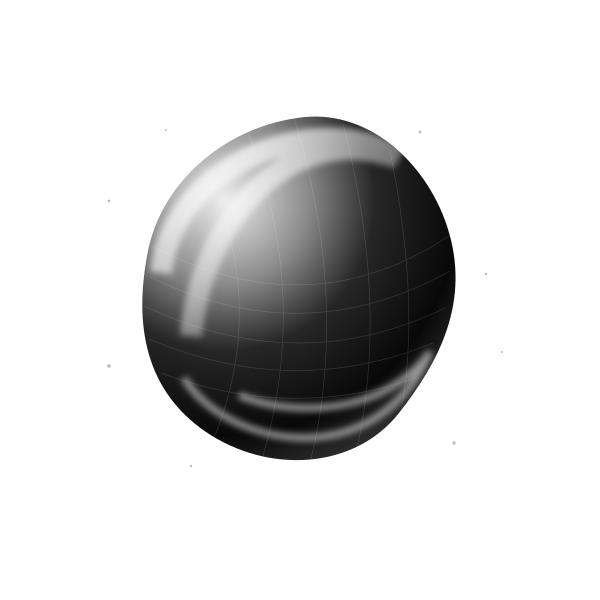

# pm: жидкая форма и частицы

Изменённые и новые файлы:

- index.html
- css/scene.css
- js/app.js
- js/scene.js
- vendor/fluid.js
- assets/orb-static.svg
- README.md

css/style.css сохранён без изменений из пользовательского коммита ceeaf0fd0823e51554bca22a3638307d3f9d7837

## Проверки

- node --check для изменённых JavaScript-файлов
- Четыре GLSL-шейдера скомпилированы и связаны в EGL / OpenGL ES
- Сфера, каркас и 1100 частиц отрисованы без ошибок GPU
- Изменение времени и курсора меняет изображение, все каналы остаются монохромными
- Проверены mobile, reduced-motion, скрытие вкладки, выход за первый экран и очистка сцены
- В локальном браузере проверены навигация, неверный и верный ответы, повторный ответ без повторного XP
- В локальном тестовом браузере WebGL недоступен: визуально проверена статичная версия, аппаратный рендер проверен отдельно

## Полный код

## index.html

````html
<!doctype html>
<html lang="ru">
<head>
<meta charset="utf-8"><meta name="viewport" content="width=device-width,initial-scale=1">
<meta name="description" content="pm физика и математика через понятные объяснения, эксперименты и задачи. Бесплатно, на русском.">
<title>pm понять, а не запомнить</title>
<link rel="stylesheet" href="https://fonts.googleapis.com/css2?family=IBM+Plex+Sans:wght@400;500;600&family=IBM+Plex+Serif:wght@400;500;600&family=IBM+Plex+Mono:wght@400;500&display=swap">
<link rel="stylesheet" href="https://cdn.jsdelivr.net/npm/katex@0.16.11/dist/katex.min.css">
<link rel="stylesheet" href="css/style.css">
<link rel="stylesheet" href="css/scene.css">
<script defer src="https://cdn.jsdelivr.net/npm/katex@0.16.11/dist/katex.min.js"></script>
<script defer src="https://cdn.jsdelivr.net/npm/gsap@3.12.5/dist/gsap.min.js"></script>
<script defer src="https://cdn.jsdelivr.net/npm/gsap@3.12.5/dist/ScrollTrigger.min.js"></script>
<script defer src="js/content.js"></script>
<script defer src="js/scene.js"></script>
<script defer src="js/app.js"></script>
</head>
<body>
<!-- Шапка и основная навигация -->
<header><a class="brand" href="#home" aria-label="pm главная">pm</a><nav aria-label="Разделы сайта"><a href="#theory">Теория</a><a href="#examples">Примеры</a><a href="#tasks">Задачи</a><a href="#formulas">Формулы</a><a href="#about">О проекте</a></nav><a class="progress-chip" href="#tasks"><span id="level">01</span> УРОВЕНЬ <span id="xp">0 XP</span></a></header>
<main id="main" tabindex="-1"></main>
<!-- Постоянные элементы интерфейса -->
<footer><a class="brand" href="#home">pm</a><p>Физика. Математика. Любопытство.</p><span>БЕСПЛАТНО · БЕЗ РЕГИСТРАЦИИ</span></footer>
<div id="transition" aria-hidden="true"></div><div class="toast" role="status" id="toast"></div>
<noscript>Для интерактивных уроков и проверки ответов включите JavaScript в браузере.</noscript>
</body></html>
````

## css/scene.css

````css
/* Главная: жидкая форма, частицы и направляющие на белом фоне */
.hero-inner {
  display:grid;
  grid-template-columns:1.12fr 1fr;
  align-items:center;
  gap:10px;
  min-height:660px;
  padding-top:55px;
  padding-bottom:55px;
  pointer-events:auto
}
.hero-copy {
  position:relative;
  z-index:3
}
.hero-copy .eyebrow {
  margin-bottom:30px
}
.hero-copy h1 {
  font-size:clamp(44px,4.55vw,68px);
  line-height:1.13;
  margin-bottom:26px;
  padding:0;
  background:none;
  backdrop-filter:none;
  -webkit-backdrop-filter:none
}
.hero-copy>p {
  max-width:390px;
  margin-bottom:30px
}
.hero-copy .meta {
  gap:12px 22px;
  flex-wrap:wrap;
  max-width:420px;
  margin-top:40px;
  font-size:9px
}
.hero-visual {
  position:relative;
  width:100%;
  height:510px;
  margin:0;
  isolation:isolate;
  user-select:none
}
.scene-grid {
  position:absolute;
  inset:0 -6%;
  background-image:radial-gradient(#b8b8b8 .7px,transparent .8px);
  background-size:22px 22px;
  mask-image:radial-gradient(ellipse,#000 15%,transparent 68%);
  -webkit-mask-image:radial-gradient(ellipse,#000 15%,transparent 68%);
  opacity:.5;
  pointer-events:none
}
.scene-guides {
  position:absolute;
  inset:4% -4%;
  width:108%;
  height:92%;
  fill:none;
  stroke:#cfcfcf;
  stroke-width:.7;
  pointer-events:none
}
.scene-guides .guide-orbit {
  stroke-dasharray:2 7
}
.hero-visual .ink-static {
  inset:18% 12%;
  width:auto;
  height:auto;
  opacity:.035
}
.hero-visual canvas {
  filter:none;
  mix-blend-mode:normal;
  opacity:0;
  pointer-events:none;
  transition:opacity 1s ease-out
}
.hero-visual #scene {
  z-index:2
}
.hero-visual #fluid {
  z-index:1;
  filter:invert(1) grayscale(1);
  mix-blend-mode:multiply;
  mask-image:radial-gradient(ellipse,#000 20%,transparent 68%);
  -webkit-mask-image:radial-gradient(ellipse,#000 20%,transparent 68%)
}
.hero-visual[data-state="running"] #scene {
  opacity:1
}
.hero-visual[data-state="running"] #fluid {
  opacity:.1
}
.scene-fallback {
  position:absolute;
  inset:0;
  width:100%;
  height:100%;
  object-fit:contain;
  opacity:1;
  transition:opacity 1s ease-out;
  pointer-events:none
}
.hero-visual[data-state="running"] .scene-fallback {
  opacity:0
}
.scene-label,.scene-note {
  position:absolute;
  z-index:3;
  font:9px/1.6 var(--mono);
  color:var(--muted);
  pointer-events:none
}
.scene-label {
  top:10px;
  left:26px;
  padding-left:14px
}
.scene-label:before {
  content:'';
  position:absolute;
  width:5px;
  height:5px;
  border-radius:50%;
  background:var(--ink);
  left:0;
  top:5px
}
.scene-note {
  bottom:5px;
  right:24px;
  text-align:right
}
.scene-note .live-note {
  display:none
}
.hero-visual[data-state="running"] .live-note {
  display:inline
}
.hero-visual[data-state="running"] .static-note {
  display:none
}
.scene-shadow {
  position:absolute;
  width:48%;
  height:7%;
  left:26%;
  bottom:12%;
  border-radius:50%;
  background:radial-gradient(ellipse,rgba(0,0,0,.14),transparent 70%);
  filter:blur(9px);
  pointer-events:none
}
.hero-number {
  right:2.2%;
  bottom:28px;
  font-size:9px
}
/* Состояния не зависят от загрузки WebGL или внешней библиотеки */
@media(min-width:901px) and (max-width:1100px) {
  .hero-inner {
    grid-template-columns:1.2fr 1fr
  }
  .hero-visual {
    height:460px
  }
  .hero-copy h1 {
    font-size:44px
  }
}
@media(max-width:900px) {
  .hero-inner {
    grid-template-columns:minmax(0,1fr) minmax(0,.8fr);
    min-height:580px;
    gap:0;
    padding-top:50px;
    padding-bottom:50px
  }
  .hero-copy h1 {
    font-size:clamp(34px,5.4vw,46px)
  }
  .hero-visual {
    height:360px
  }
  .hero-visual canvas {
    display:none!important
  }
  .hero-visual .scene-fallback {
    opacity:1
  }
  .scene-label {
    left:12px;
    top:0;
    font-size:8px
  }
  .scene-note {
    font-size:8px;
    right:0
  }
}
@media(max-width:600px) {
  .hero-inner {
    display:flex;
    flex-direction:column;
    align-items:stretch;
    padding:44px 6% 26px
  }
  .hero-copy h1 {
    font-size:clamp(34px,8.5vw,48px)
  }
  .hero-copy>p {
    max-width:360px
  }
  .hero-copy .meta {
    margin-top:28px
  }
  .hero-visual {
    width:min(100%,420px);
    height:auto;
    aspect-ratio:1.1;
    margin:24px auto 5px
  }
  .scene-label {
    top:8px
  }
  .scene-note {
    right:8px;
    bottom:0
  }
}
@media(prefers-reduced-motion:reduce) {
  .hero-visual canvas {
    display:none!important
  }
  .hero-visual .scene-fallback {
    opacity:1!important
  }
  .scene-note .live-note {
    display:none!important
  }
  .scene-note .static-note {
    display:inline!important
  }
}
@media print {
  .hero-visual,.hero-number {
    display:none!important
  }
  .hero,.hero-inner {
    min-height:0;
    display:block;
    padding:0;
    background:#fff!important
  }
}
````

## js/app.js

````javascript
/* Навигация, прогресс и учебные взаимодействия. */
'use strict';
const main=document.querySelector('main'), reduce=matchMedia('(prefers-reduced-motion: reduce)');
let solved=new Set();try{const a=JSON.parse(localStorage.getItem('tush-solved')||'[]');if(Array.isArray(a))solved=new Set(a.filter(id=>COURSE.some(t=>t.id===id)))}catch{}
const subjects={physics:'Физика',math:'Математика'};
const math=f=>`<div class="formula math" data-tex="${f}">${f}</div>`;
const steps=a=>a.map((s,i)=>`<details><summary>Шаг ${i+1}</summary><p>${s}</p></details>`).join('');
const header=(n,title,desc)=>`<div class="page-head reveal"><div class="eyebrow">${n} / ТЕТРАДЬ ИССЛЕДОВАТЕЛЯ</div><h1>${title}</h1><p>${desc}</p></div>`;
function progress(){let xp=solved.size*25;document.querySelector('#xp').textContent=xp+' XP';document.querySelector('#level').textContent=String(1+Math.floor(xp/100)).padStart(2,'0')}
function home(){return `<section class="hero">
  <div class="hero-inner">
    <div class="hero-copy">
      <div class="eyebrow">ОНЛАЙН-ТЕТРАДЬ · ФИЗИКА И МАТЕМАТИКА</div>
      <h1>Меньше зубрить<br><em>Больше понимать</em></h1>
      <p>У сложных вещей есть простые объяснения<br>Исследуй законы мира, решай задачи и собирай знания шаг за шагом</p>
      <a class="btn primary" href="#theory">Начать исследование <span>↗</span></a>
      <div class="meta"><span>12 ТЕМ ДЛЯ ПЕРВОГО ШАГА</span><span>7–10 КЛАССЫ</span><span>В ТВОЁМ ТЕМПЕ</span></div>
    </div>
    <figure class="hero-visual" data-state="static" aria-label="Жидкая монохромная сфера и поле частиц">
      <div class="scene-grid" aria-hidden="true"></div>
      <svg class="scene-guides" viewBox="0 0 600 600" aria-hidden="true">
        <circle class="guide-orbit" cx="300" cy="300" r="240"/>
        <ellipse cx="300" cy="300" rx="265" ry="110" transform="rotate(-28 300 300)"/>
        <path d="M32 300h24m488 0h24M300 32v24m0 488v24"/>
      </svg>
      <div class="ink-static" aria-hidden="true"></div>
      <div class="scene-shadow" aria-hidden="true"></div>
      
      <canvas id="fluid" aria-hidden="true"></canvas>
      <canvas id="scene" aria-hidden="true"></canvas>
      <span class="scene-label">ФОРМА · ДВИЖЕНИЕ · СВЯЗЬ</span>
      <figcaption class="scene-note"><span class="live-note">ДВИГАЙ КУРСОРОМ<br>НАБЛЮДАЙ ЗА ФОРМОЙ</span><span class="static-note">У КАЖДОЙ ФОРМЫ<br>ЕСТЬ СВОЙ ЗАКОН</span></figcaption>
    </figure>
  </div>
  <span class="hero-number">01 ВСЁ НАЧИНАЕТСЯ С ВОПРОСА</span>
</section><div class="ribbon"><span>ЗНАНИЯ НЕ ТРЕБУЮТ ПОДПИСКИ</span><span>НИКАКИХ ОЦЕНОК. ТОЛЬКО ПРОГРЕСС.</span><span>ЛЮБОПЫТСТВО ПРИВЕТСТВУЕТСЯ ↗</span></div><section class="wrap"><div class="section-head reveal"><div><div class="eyebrow">01 / ВЫБЕРИ НАПРАВЛЕНИЕ</div><h2>Две науки.<br>Один мир.</h2></div><p>От движения мяча до движения мысли. Начни с того, что вызывает вопросы.</p></div><div class="grid"><a class="card subject reveal" href="#theory/physics"><span class="eyebrow">01 / ФИЗИКА</span><span class="symbol">F</span><div><h3>Как устроен мир</h3><p>Движение, силы, энергия и электричество. Проверь законы на практике.</p></div><div class="card-bottom"><span>6 ТЕМ · 6 ЗАДАЧ</span><span>Исследовать ↗</span></div></a><a class="card subject dark reveal" href="#theory/math"><span class="eyebrow">02 / МАТЕМАТИКА</span><span class="symbol">∑</span><div><h3>Язык закономерностей</h3><p>От дробей до производных. Находи связи и учись рассуждать.</p></div><div class="card-bottom"><span>6 ТЕМ · 6 ЗАДАЧ</span><span>Разобраться ↗</span></div></a></div></section><section class="quote reveal"><p>«Важнее не переставать задавать вопросы»</p><span>ПРИНЦИП НАШЕЙ ТЕТРАДИ</span></section><section class="wrap"><div class="eyebrow">02 / ТВОЙ МАРШРУТ</div><h2 class="reveal">Знание оставляет след.</h2><div class="method"><article class="reveal"><b>01 РАЗБЕРИСЬ</b><h3>Одна идея за раз</h3><p>Короткая теория, смысл формул и примеры из жизни.</p></article><article class="reveal"><b>02 ПОПРОБУЙ</b><h3>Ошибаться можно</h3><p>Решения по шагам и подсказки помогут найти свой путь.</p></article><article class="reveal"><b>03 ПРОДВИГАЙСЯ</b><h3>Каждый шаг считается</h3><p>25 XP за задачу. Новый уровень каждые 100 XP. Прогресс сохраняется в этом браузере.</p></article></div></section>`}
function filters(subject=''){return `<div class="filters no-print"><select id="subject" aria-label="Предмет"><option value="">Все предметы</option value="physics" ${subject==='physics'?'selected':''}>Физика</option><option value="math" ${subject==='math'?'selected':''}>Математика</option></select><select id="grade" aria-label="Класс"><option value="">Все классы</option>${[7,8,9,10].map(g=>`<option value="${g}">${g} класс</option>`).join('')}</select><input class="search" id="search" aria-label="Поиск по темам" placeholder="Найти тему…" type="search"></div>`}
function catalog(page,subject){const info={theory:['01','Понять суть.','Короткие главы, в которых у каждой формулы есть смысл. Выбери предмет и класс.'],examples:['02','Разобрать по шагам.','Не торопись смотреть ответ. Попробуй предположить следующий шаг, затем раскрой его.'],tasks:['03','Твоя очередь.','Введи число без единиц измерения. Принимаются десятичные числа с точкой или запятой и дроби вроде 3/4. За первое решение 25 XP.'],formulas:['04','Всё под рукой.','Справочник основных формул из наших уроков. Отфильтруй нужные темы и сохрани их через «Печать → Сохранить как PDF».']};return `<div class="wrap">${header(...info[page])}${page==='tasks'?`<p class="mono">РЕШЕНО ${solved.size} / ${COURSE.length} <span class="muted">· ${solved.size*25} XP</span></p><div class="xp-bar"><span style="width:${solved.size/COURSE.length*100}%"></span></div>`:''}${filters(subject)}${page==='formulas'?'<button class="btn small no-print" id="print">Печать / PDF ↗</button>':''}<div id="results"></div>${page==='theory'?lab():''}</div>`}
function lab(){return `<section class="lab reveal"><div class="eyebrow">МИНИ-ЛАБОРАТОРИЯ / ВТОРОЙ ЗАКОН НЬЮТОНА</div><h3>Сдвинь с места.</h3><p class="muted">Меняй силу и массу. Наблюдай движение из состояния покоя без трения в течение 3 секунд.</p><div class="lab-controls"><label>Сила: <output id="force-value">10</output> Н<input id="force" type="range" min="0" max="30" value="10"></label><label>Масса: <output id="mass-value">5</output> кг<input id="mass" type="range" min="1" max="15" value="5"></label></div><div class="track"><div class="cart" id="cart"></div></div><p class="lab-output" id="lab-output"></p><button class="btn small" id="run">Запустить опыт ↗</button><p class="muted">Масштаб: длина дорожки соответствует 150 м. При уменьшенной анимации показываем конечное положение.</p></section>`}
function renderResults(page){const sub=document.querySelector('#subject').value,grade=document.querySelector('#grade').value,q=document.querySelector('#search').value.toLowerCase().trim();const list=COURSE.filter(t=>(!sub||t.subject===sub)&&(!grade||t.grade===+grade)&&(!q||(t.title+' '+t.intro).toLowerCase().includes(q)));const results=document.querySelector('#results');if(!list.length){results.innerHTML='<p class="empty">Такой темы пока нет в этой тетради. Попробуй другой запрос или класс.</p>';return}if(page==='formulas'){results.innerHTML=`<table class="formula-table"><thead><tr><th>Тема</th><th>Формула</th><th>Обозначения / условия</th></tr></thead><tbody>${list.map(t=>`<tr><td>${t.title}<br><small>${subjects[t.subject]} · ${t.grade} класс</small></td><td><span class="math" data-tex="${t.formula}">${t.formula}</span></td><td>${t.units}</td></tr>`).join('')}</tbody></table>`}else results.innerHTML=`<div class="grid">${list.map(t=>`<article class="card lesson" id="${t.id}"><div class="tag">${subjects[t.subject].toUpperCase()} / ${t.grade} КЛАСС</div><h3>${t.title}</h3>${page==='theory'?`<p>${t.intro}</p>${math(t.formula)}<p class="mono muted" style="font-size:11px">${t.units}</p><p class="muted">${t.note}</p><a class="btn small" href="#tasks/${t.subject}">Закрепить ↗</a>`:page==='examples'?`<p>${t.example}</p>${steps(t.exampleSteps)}`:`${solved.has(t.id)?'<span class="task-done">✓ РЕШЕНО</span>':''}<p>${t.question}</p><form data-task="${t.id}"><label class="mono" style="font-size:11px" for="answer-${t.id}">ТВОЙ ОТВЕТ</label><input class="answer" id="answer-${t.id}" name="answer" autocomplete="off" placeholder="Введи число или дробь" required><button class="btn small primary" type="submit">Проверить ↗</button><p class="feedback" aria-live="polite"></p></form><details><summary>Нужна подсказка?</summary><p>${t.hint}</p></details><details><summary>Показать решение</summary><div>${t.steps.map(s=>`<p>${s}</p>`).join('')}</div></details>`}</article>`).join('')}</div>`;renderMath();cleanInterfaceText()}
function renderMath(){if(window.katex)document.querySelectorAll('[data-tex]').forEach(el=>katex.render(el.dataset.tex,el,{throwOnError:false,output:'html',strict:false}))}
function about(){return `<div class="wrap">${header('05','Место для любопытства.','pm открытая учебная тетрадь по физике и математике. Без оплаты и регистрации.')}<div class="about-copy"><h2>Понять значит связать.</h2><p>Формула становится полезной, когда ты понимаешь, что за ней стоит. Здесь можно читать объяснения, разбирать примеры по шагам и проверять себя без страха получить плохую оценку.</p><p>Первая тетрадь охватывает 12 вводных тем для 7–10 классов. Это отправная точка, а не полный школьный курс. Классы указаны ориентировочно: порядок тем в разных программах отличается.</p><h2>Твой прогресс принадлежит тебе.</h2><p>Решённые задачи сохраняются только в браузере на этом устройстве. Для сохранения нужен доступ к локальному хранилищу. Если очистить данные сайта, прогресс исчезнет. За каждую уникальную задачу начисляется 25 XP.</p><h2>На связи.</h2><p>Автор: Maxim Samarin. Нашёл ошибку или придумал тему? Напиши в обсуждение задачи на GitHub.</p><a class="btn" href="https://github.com/sannder01/pm/issues" target="_blank" rel="noopener">Предложить улучшение ↗</a><p style="margin-top:30px;font-size:13px">Код проекта: <a href="https://github.com/sannder01/pm">github.com/sannder01/pm</a><br>Чернила: адаптация WebGL Fluid Simulation Павла Добрякова (MIT). Формулы: KaTeX. Анимация появления: GSAP ScrollTrigger. Жидкая форма и частицы: собственные шейдеры pm на WebGL.</p></div></div>`}
let routeTimer,homeEffects;function route(){homeEffects?.destroy();homeEffects=null;window.stopTushFluid?.();cancelAnimationFrame(labFrame);const [raw,subject]=location.hash.slice(1).split('/'),page=['theory','examples','tasks','formulas','about'].includes(raw)?raw:'home';main.innerHTML=page==='home'?home():page==='about'?about():catalog(page,subject);document.querySelectorAll('nav a').forEach(a=>a.classList.toggle('active',a.hash==='#'+page));document.title=({home:'Понять, а не запомнить',theory:'Теория',examples:'Примеры',tasks:'Задачи',formulas:'Справочник формул',about:'О проекте'}[page])+' pm';if(document.querySelector('#results')){renderResults(page);document.querySelectorAll('.filters select,.filters input').forEach(el=>el.addEventListener('input',()=>renderResults(page)))}document.querySelector('#print')?.addEventListener('click',()=>window.print());if(page==='theory')initLab();if(page==='home')homeEffects=window.PMScene?.mount(document.querySelector('.hero'),{startFluid:initFluid,stopFluid:()=>window.stopTushFluid?.()});cleanInterfaceText();animate();window.scrollTo(0,0)}
function animate(){if(!reduce.matches&&window.gsap&&window.ScrollTrigger){gsap.registerPlugin(ScrollTrigger);ScrollTrigger.getAll().forEach(t=>t.kill());document.querySelectorAll('.reveal').forEach(el=>{gsap.fromTo(el,{opacity:0,y:18,clipPath:'inset(0 15% 0 0)'},{opacity:1,y:0,clipPath:'inset(0 0% 0 0)',duration:.9,ease:'power1.out',scrollTrigger:{trigger:el,start:'top 94%',once:true}})})}}
window.addEventListener('hashchange',()=>{clearTimeout(routeTimer);if(reduce.matches||!window.gsap){route();return}gsap.killTweensOf('#transition');gsap.fromTo('#transition',{scale:0,opacity:0},{scale:2.5,opacity:1,duration:.6,ease:'power1.out',onComplete:()=>{route();gsap.to('#transition',{scale:3,opacity:0,duration:.6,ease:'power1.out'})}})});
document.addEventListener('pointermove',e=>{const b=e.target.closest('.btn');if(b){const r=b.getBoundingClientRect();b.style.setProperty('--x',(e.clientX-r.left)+'px');b.style.setProperty('--y',(e.clientY-r.top)+'px')}});
function parseAnswer(value){const s=value.trim().replace(',','.');if(/^[+-]?(?:\d+(?:\.\d*)?|\.\d+)$/.test(s))return Number(s);const f=s.match(/^([+-]?(?:\d+(?:\.\d*)?|\.\d+))\s*\/\s*([+-]?(?:\d+(?:\.\d*)?|\.\d+))$/);return f&&Number(f[2])!==0?Number(f[1])/Number(f[2]):NaN}
document.addEventListener('submit',e=>{const form=e.target;if(!form.dataset.task)return;e.preventDefault();const t=COURSE.find(t=>t.id===form.dataset.task),value=parseAnswer(new FormData(form).get('answer')),out=form.querySelector('.feedback');if(!Number.isFinite(value)){out.textContent='Введи число или дробь с ненулевым знаменателем.';return}if(Math.abs(value-t.answer)>1e-8*Math.max(1,Math.abs(t.answer))){out.textContent='Пока не сходится. Проверь вычисления или открой подсказку.';return}out.textContent='✓ Верно! Ты разобрался.';out.classList.add('success');if(!solved.has(t.id)){solved.add(t.id);try{localStorage.setItem('tush-solved',JSON.stringify([...solved]))}catch{out.textContent+=' Прогресс сохранён только до закрытия страницы.'}progress();const toast=document.querySelector('#toast');toast.textContent='+25 XP · Ещё один понятный закон';toast.classList.add('visible');setTimeout(()=>toast.classList.remove('visible'),2500);form.closest('article').insertAdjacentHTML('afterbegin','<span class="task-done">✓ РЕШЕНО</span>')}});
/* Мини-лаборатория: s = at² / 2, дорожка соответствует 150 м. */
let labFrame;function initLab(){const f=document.querySelector('#force'),m=document.querySelector('#mass'),cart=document.querySelector('#cart');function values(){cancelAnimationFrame(labFrame);document.querySelector('#force-value').textContent=f.value;document.querySelector('#mass-value').textContent=m.value;document.querySelector('#lab-output').textContent=`a = F / m = ${(+f.value/+m.value).toFixed(2)} м/с²`;cart.style.transform='translateX(0)'}f.oninput=m.oninput=values;values();document.querySelector('#run').onclick=()=>{cancelAnimationFrame(labFrame);const a=+f.value/+m.value,max=cart.parentElement.clientWidth-40,start=performance.now();function frame(now){if(!cart.isConnected)return;const t=reduce.matches?3:Math.min((now-start)/1000,3),s=.5*a*t*t;cart.style.transform=`translateX(${s/150*max}px)`;document.querySelector('#lab-output').textContent=`a = ${a.toFixed(2)} м/с² · t = ${t.toFixed(1)} с · s = ${s.toFixed(2)} м`;if(t<3)labFrame=requestAnimationFrame(frame)}labFrame=requestAnimationFrame(frame)}}
/* Загрузка чернил по запросу видимой сцены, с проверкой после загрузки */
let fluidReady;
function initFluid() {
  const visual=document.querySelector('.hero-visual');
  if (!visual || reduce.matches || innerWidth<=900 || document.hidden) return;
  if (window.startTushFluid) { window.startTushFluid(); return; }
  if (!fluidReady) fluidReady=new Promise((resolve,reject)=>{
    const script=document.createElement('script');
    script.src='vendor/fluid.js';
    script.onload=resolve;
    script.onerror=()=>{script.remove();fluidReady=null;reject(new Error('Чернила недоступны'))};
    document.body.append(script);
  });
  fluidReady.then(()=>{
    if (visual.isConnected && !reduce.matches && innerWidth>900 && !document.hidden && homeEffects?.isRunning()) window.startTushFluid?.();
  }).catch(()=>{});
}
progress();route();

/* Редакционный стиль: без конечных точек, многоточий и длинных тире. */
function cleanInterfaceText() {
    const clean = text => text.replace(/\s*[—]\s*/g, ' ').replace(/--+/g, ' ').replace(/[.\u2026]+(\s*)$/u, '$1');
    const walker = document.createTreeWalker(document.body, NodeFilter.SHOW_TEXT);
    const nodes = [];
    while (walker.nextNode()) {
        const node = walker.currentNode;
        if (!node.parentElement.closest('script, style, code, pre, .katex, [data-tex]')) nodes.push(node);
    }
    nodes.forEach(node => { node.nodeValue = clean(node.nodeValue); });
    document.querySelectorAll('[placeholder], [aria-label]').forEach(el => {
        for (const attr of ['placeholder', 'aria-label']) {
            if (el.hasAttribute(attr)) el.setAttribute(attr, clean(el.getAttribute(attr)));
        }
    });
}
cleanInterfaceText();
document.addEventListener('submit', () => queueMicrotask(cleanInterfaceText));
````

## js/scene.js

````javascript
/* Декоративная сцена pm: нативный WebGL, без React, Three.js и сборки */
'use strict';

window.PMScene = (() => {
  const vertex = `
    precision highp float;
    attribute vec3 aPosition;
    uniform float uTime;
    uniform float uAspect;
    uniform vec2 uPointer;
    uniform float uHover;
    uniform float uLayer;
    varying vec3 vPosition;
    varying vec3 vNormal;

    vec3 rotate(vec3 p) {
      float a = uTime * .065;
      return vec3(cos(a)*p.x + sin(a)*p.z, p.y, -sin(a)*p.x + cos(a)*p.z);
    }
    vec3 deform(vec3 n) {
      float t = uTime * .42;
      float wave = sin(n.x*3.7 + t) * sin(n.y*3.1 - t*.7) * .075;
      wave += sin(n.z*4.2 + n.x*2.0 - t*.85) * .045;
      vec3 direction = normalize(vec3(uPointer, .85));
      float attraction = exp(-dot(n-direction,n-direction)*4.8) * uHover * .2;
      return n * (1.04 + wave + attraction + uLayer*.002);
    }
    void main() {
      vec3 n = normalize(rotate(aPosition));
      vec3 tangent = normalize(cross(abs(n.y)>.98 ? vec3(1.,0.,0.) : vec3(0.,1.,0.),n));
      vec3 bitangent = normalize(cross(n,tangent));
      vec3 p = deform(n);
      vec3 pt = deform(normalize(n+tangent*.006));
      vec3 pb = deform(normalize(n+bitangent*.006));
      vNormal = normalize(cross(pt-p,pb-p));
      vPosition = p;
      gl_Position = vec4(p.x/(uAspect*1.7),p.y/1.7,-p.z*.22,1.);
    }
  `;
  const fragment = `
    precision mediump float;
    uniform float uWire;
    varying vec3 vPosition;
    varying vec3 vNormal;

    float studio(vec3 r) {
      float largeLight = exp(-pow((r.x + .34 + r.y*.32)*3.8,2.)) * smoothstep(-.65,.6,r.y);
      float strip = exp(-pow((r.x - .6 + r.y*.22)*16.,2.)) * .58;
      float bottom = exp(-pow((r.y + .63)*10.,2.)) * .4;
      return clamp(largeLight+strip+bottom,0.,1.);
    }
    void main() {
      vec3 n = normalize(vNormal);
      vec3 eye = normalize(vec3(0.,0.,4.5)-vPosition);
      if (uWire>.5) {
        gl_FragColor = vec4(vec3(.85),.055*max(n.z,0.));
        return;
      }
      float fresnel = pow(1.-max(dot(n,eye),0.),3.);
      float diffuse = max(dot(n,normalize(vec3(-.65,.8,1.6))),0.);
      vec3 reflected = reflect(-eye,n);
      vec3 refracted = refract(-eye,n,.74);
      float bands = pow(.5+.5*sin((refracted.x+refracted.y*.35)*25.),28.);
      float value = .025 + diffuse*.095 + studio(reflected)*.8;
      value += fresnel*.23 + bands*(1.-fresnel)*.035;
      gl_FragColor = vec4(vec3(clamp(value,0.,1.)),1.);
    }
  `;
  const pointVertex = `
    precision highp float;
    attribute vec3 aPosition;
    attribute float aSeed;
    uniform float uTime;
    uniform float uAspect;
    uniform float uRatio;
    uniform vec2 uPointer;
    uniform float uHover;
    varying float vAlpha;
    void main() {
      float a = uTime*.027;
      vec3 p = vec3(cos(a)*aPosition.x+sin(a)*aPosition.z,aPosition.y,-sin(a)*aPosition.x+cos(a)*aPosition.z);
      p.y += sin(uTime*.25+aSeed*18.)*.035;
      vec2 delta = p.xy-uPointer;
      float distanceToPointer = max(length(delta),.01);
      p.xy += delta/distanceToPointer * exp(-distanceToPointer*distanceToPointer*3.5) * uHover*.24;
      gl_Position = vec4(p.x/(uAspect*1.7),p.y/1.7,-p.z*.22,1.);
      gl_PointSize = uRatio*(1.+aSeed*1.2);
      vAlpha = .2 + aSeed*.26;
    }
  `;
  const pointFragment = `
    precision mediump float;
    varying float vAlpha;
    void main() {
      float d = length(gl_PointCoord-vec2(.5));
      if (d>.5) discard;
      gl_FragColor = vec4(vec3(.2),vAlpha*(1.-smoothstep(.15,.5,d)));
    }
  `;

  /* Сетка сферы, её тонкий каркас и детерминированное облако частиц */
  function geometry() {
    const positions = [], triangles = [], lines = [];
    const latitudes = 64, longitudes = 96, stride = longitudes + 1;
    for (let y=0;y<=latitudes;y++) {
      const phi = y/latitudes*Math.PI;
      for (let x=0;x<=longitudes;x++) {
        const theta = x/longitudes*Math.PI*2;
        positions.push(Math.sin(phi)*Math.cos(theta),Math.cos(phi),Math.sin(phi)*Math.sin(theta));
        if (y<latitudes && x<longitudes) {
          const i = y*stride+x;
          triangles.push(i,i+1,i+stride,i+1,i+stride+1,i+stride);
          if (y%4===0) lines.push(i,i+1);
          if (x%4===0) lines.push(i,i+stride);
        }
      }
    }
    let seed = 17;
    const random = () => {
      seed = (seed*1664525+1013904223)>>>0;
      return seed/4294967296;
    };
    const particles = [], seeds = [];
    for (let i=0;i<1100;i++) {
      const theta = random()*Math.PI*2, height = random()*2-1;
      const radius = 1.25+random()*.6, ring = Math.sqrt(1-height*height);
      particles.push(Math.cos(theta)*ring*radius,height*radius,Math.sin(theta)*ring*radius);
      seeds.push(random());
    }
    return {
      positions:new Float32Array(positions), triangles:new Uint16Array(triangles),
      lines:new Uint16Array(lines), particles:new Float32Array(particles), seeds:new Float32Array(seeds)
    };
  }

  function createRenderer(canvas) {
    const gl = canvas.getContext('webgl',{
      alpha:true, antialias:true, depth:true, powerPreference:'low-power', premultipliedAlpha:false
    });
    if (!gl) {
      console.info('pm: WebGL недоступен, используется статичная форма');
      return null;
    }
    const resources = {programs:[],shaders:[],buffers:[]};
    function destroy() {
      resources.buffers.forEach(buffer=>gl.deleteBuffer(buffer));
      resources.programs.forEach(program=>gl.deleteProgram(program));
      resources.shaders.forEach(shader=>gl.deleteShader(shader));
      gl.getExtension('WEBGL_lose_context')?.loseContext();
    }
    function program(vertexSource,fragmentSource) {
      function compile(type,source) {
        const shader = gl.createShader(type);
        resources.shaders.push(shader);
        gl.shaderSource(shader,source);
        gl.compileShader(shader);
        if (!gl.getShaderParameter(shader,gl.COMPILE_STATUS)) throw new Error('Шейдер pm не скомпилирован');
        return shader;
      }
      const result = gl.createProgram();
      resources.programs.push(result);
      gl.attachShader(result,compile(gl.VERTEX_SHADER,vertexSource));
      gl.attachShader(result,compile(gl.FRAGMENT_SHADER,fragmentSource));
      gl.linkProgram(result);
      if (!gl.getProgramParameter(result,gl.LINK_STATUS)) throw new Error('Шейдеры pm не связаны');
      const uniforms = {};
      for (const name of ['uTime','uAspect','uPointer','uHover','uLayer','uWire','uRatio']) {
        uniforms[name] = gl.getUniformLocation(result,name);
      }
      return {program:result,uniforms,position:gl.getAttribLocation(result,'aPosition'),seed:gl.getAttribLocation(result,'aSeed')};
    }
    function buffer(data,target=gl.ARRAY_BUFFER) {
      const result = gl.createBuffer();
      resources.buffers.push(result);
      gl.bindBuffer(target,result);
      gl.bufferData(target,data,gl.STATIC_DRAW);
      return result;
    }
    try {
      const sphere = program(vertex,fragment), points = program(pointVertex,pointFragment), data = geometry();
      const positionBuffer = buffer(data.positions), particleBuffer = buffer(data.particles), seedBuffer = buffer(data.seeds);
      const triangleBuffer = buffer(data.triangles,gl.ELEMENT_ARRAY_BUFFER), lineBuffer = buffer(data.lines,gl.ELEMENT_ARRAY_BUFFER);
      let width = 1, height = 1, ratio = 1;
      function resize() {
        const rect = canvas.getBoundingClientRect();
        ratio = Math.min(devicePixelRatio||1,1.5);
        width = Math.max(1,Math.round(rect.width*ratio));
        height = Math.max(1,Math.round(rect.height*ratio));
        if (canvas.width!==width || canvas.height!==height) {
          canvas.width=width;
          canvas.height=height;
          gl.viewport(0,0,width,height);
        }
      }
      function use(info,time,pointer,hover) {
        gl.useProgram(info.program);
        gl.uniform1f(info.uniforms.uTime,time);
        gl.uniform1f(info.uniforms.uAspect,width/height);
        gl.uniform2f(info.uniforms.uPointer,pointer.x,pointer.y);
        gl.uniform1f(info.uniforms.uHover,hover);
      }
      function position(info,value) {
        gl.bindBuffer(gl.ARRAY_BUFFER,value);
        gl.enableVertexAttribArray(info.position);
        gl.vertexAttribPointer(info.position,3,gl.FLOAT,false,0,0);
      }
      return {
        resize,destroy,
        draw(time,pointer,hover) {
          if (gl.isContextLost()) return false;
          gl.clearColor(0,0,0,0);
          gl.clear(gl.COLOR_BUFFER_BIT|gl.DEPTH_BUFFER_BIT);
          gl.enable(gl.DEPTH_TEST);
          gl.depthFunc(gl.LEQUAL);
          gl.depthMask(true);
          gl.disable(gl.BLEND);
          gl.enable(gl.CULL_FACE);
          use(sphere,time,pointer,hover);
          position(sphere,positionBuffer);
          gl.uniform1f(sphere.uniforms.uLayer,0);
          gl.uniform1f(sphere.uniforms.uWire,0);
          gl.bindBuffer(gl.ELEMENT_ARRAY_BUFFER,triangleBuffer);
          gl.drawElements(gl.TRIANGLES,data.triangles.length,gl.UNSIGNED_SHORT,0);

          gl.enable(gl.BLEND);
          gl.blendFunc(gl.SRC_ALPHA,gl.ONE_MINUS_SRC_ALPHA);
          gl.depthMask(false);
          gl.uniform1f(sphere.uniforms.uLayer,1);
          gl.uniform1f(sphere.uniforms.uWire,1);
          gl.bindBuffer(gl.ELEMENT_ARRAY_BUFFER,lineBuffer);
          gl.drawElements(gl.LINES,data.lines.length,gl.UNSIGNED_SHORT,0);

          use(points,time,pointer,hover);
          position(points,particleBuffer);
          gl.bindBuffer(gl.ARRAY_BUFFER,seedBuffer);
          gl.enableVertexAttribArray(points.seed);
          gl.vertexAttribPointer(points.seed,1,gl.FLOAT,false,0,0);
          gl.uniform1f(points.uniforms.uRatio,ratio);
          gl.disable(gl.CULL_FACE);
          gl.drawArrays(gl.POINTS,0,data.seeds.length);
          gl.disableVertexAttribArray(points.seed);
          gl.depthMask(true);
          return true;
        }
      };
    } catch (error) {
      destroy();
      console.info('pm: используется статичная форма',error.message);
      return null;
    }
  }

  /* Один владелец кадров и ресурсов на один открытый первый экран */
  function mount(hero,{startFluid=()=>{},stopFluid=()=>{}}={}) {
    const visual = hero.querySelector('.hero-visual');
    const motion = matchMedia('(prefers-reduced-motion: reduce)');
    const small = matchMedia('(max-width: 900px)');
    const print = matchMedia('print');
    const listeners = new AbortController();
    let canvas = visual.querySelector('#scene'), renderer = null;
    let frame = 0, last = 0, time = 0, running = false, destroyed = false, failed = false;
    let inView = true, over = false, hover = 0;
    const target = {x:0,y:0}, pointer = {x:0,y:0};

    function stop() {
      running=false;
      cancelAnimationFrame(frame);
      frame=0;
      last=0;
      stopFluid();
      visual.dataset.state='static';
    }
    function release() {
      if (!renderer) return;
      canvas.removeEventListener('webglcontextlost',contextLost);
      renderer.destroy();
      renderer=null;
      const next = canvas.cloneNode(false);
      canvas.replaceWith(next);
      canvas=next;
    }
    function contextLost(event) {
      event.preventDefault();
      failed=true;
      stop();
      release();
    }
    function tick(now) {
      if (!running || destroyed) return;
      frame=requestAnimationFrame(tick);
      if (last && now-last<1000/30) return;
      const dt=last?Math.min((now-last)/1000,.1):1/30;
      last=now;
      time+=dt;
      // Экспоненциальное сглаживание: около 0,8 с до целевой формы
      const ease=1-Math.exp(-dt*6);
      pointer.x+=(target.x-pointer.x)*ease;
      pointer.y+=(target.y-pointer.y)*ease;
      hover+=((over?1:0)-hover)*ease;
      if (!renderer.draw(time,pointer,hover)) {
        failed=true;
        stop();
        release();
        return;
      }
      visual.dataset.state='running';
    }
    function sync() {
      if (destroyed) return;
      const permitted=!motion.matches&&!small.matches&&!print.matches&&!failed;
      if (!permitted || !inView || document.hidden) {
        stop();
        if (!permitted) release();
        return;
      }
      if (!renderer) {
        renderer=createRenderer(canvas);
        if (!renderer) {
          failed=true;
          stop();
          return;
        }
        canvas.addEventListener('webglcontextlost',contextLost);
      }
      renderer.resize();
      if (running) return;
      running=true;
      startFluid();
      frame=requestAnimationFrame(tick);
    }
    visual.addEventListener('pointermove',event=>{
      if (event.pointerType==='touch') return;
      const rect=visual.getBoundingClientRect();
      target.x=((event.clientX-rect.left)/rect.width*2-1)*(rect.width/rect.height)*1.7;
      target.y=(1-(event.clientY-rect.top)/rect.height*2)*1.7;
      over=true;
    },{signal:listeners.signal,passive:true});
    visual.addEventListener('pointerleave',()=>{over=false;target.x=target.y=0},{signal:listeners.signal});
    document.addEventListener('visibilitychange',sync,{signal:listeners.signal});
    window.addEventListener('pagehide',stop,{signal:listeners.signal});
    window.addEventListener('pageshow',sync,{signal:listeners.signal});
    for (const media of [motion,small,print]) media.addEventListener('change',sync);
    const resize=new ResizeObserver(()=>{renderer?.resize();sync()});
    resize.observe(visual);
    const intersection=new IntersectionObserver(entries=>{
      inView=entries[0].isIntersecting;
      sync();
    },{threshold:0});
    intersection.observe(hero);
    sync();
    return {
      isRunning:()=>running,
      destroy() {
        if (destroyed) return;
        destroyed=true;
        stop();
        release();
        listeners.abort();
        resize.disconnect();
        intersection.disconnect();
        for (const media of [motion,small,print]) media.removeEventListener('change',sync);
      }
    };
  }
  return {mount};
})();
````

## vendor/fluid.js

````javascript
/*
MIT License

Copyright (c) 2017 Pavel Dobryakov

Permission is hereby granted, free of charge, to any person obtaining a copy
of this software and associated documentation files (the "Software"), to deal
in the Software without restriction, including without limitation the rights
to use, copy, modify, merge, publish, distribute, sublicense, and/or sell
copies of the Software, and to permit persons to whom the Software is
furnished to do so, subject to the following conditions:

The above copyright notice and this permission notice shall be included in all
copies or substantial portions of the Software.

THE SOFTWARE IS PROVIDED "AS IS", WITHOUT WARRANTY OF ANY KIND, EXPRESS OR
IMPLIED, INCLUDING BUT NOT LIMITED TO THE WARRANTIES OF MERCHANTABILITY,
FITNESS FOR A PARTICULAR PURPOSE AND NONINFRINGEMENT. IN NO EVENT SHALL THE
AUTHORS OR COPYRIGHT HOLDERS BE LIABLE FOR ANY CLAIM, DAMAGES OR OTHER
LIABILITY, WHETHER IN AN ACTION OF CONTRACT, TORT OR OTHERWISE, ARISING FROM,
OUT OF OR IN CONNECTION WITH THE SOFTWARE OR THE USE OR OTHER DEALINGS IN THE
SOFTWARE.
*/

'use strict';
window.startTushFluid = function () {
try {

// Simulation section

const previousCanvas = document.querySelector('#fluid');
if (!previousCanvas || matchMedia('(prefers-reduced-motion: reduce)').matches || innerWidth <= 900 || document.hidden) return;
window.stopTushFluid?.();
// Новый canvas позволяет вернуться на главную после освобождения контекста.
const canvas = previousCanvas.cloneNode(false);
previousCanvas.replaceWith(canvas);
let stopped = false;
let fluidFrame = 0;
let fluidGl = null;
const inputController = new AbortController();
window.stopTushFluid = () => {
    if (stopped) return;
    stopped = true;
    cancelAnimationFrame(fluidFrame);
    inputController.abort();
    fluidGl?.getExtension('WEBGL_lose_context')?.loseContext();
};
resizeCanvas();

let config = {
    SIM_RESOLUTION: 64,
    DYE_RESOLUTION: 256,
    CAPTURE_RESOLUTION: 512,
    DENSITY_DISSIPATION: 1,
    VELOCITY_DISSIPATION: 0.2,
    PRESSURE: 0.8,
    PRESSURE_ITERATIONS: 12,
    CURL: 18,
    SPLAT_RADIUS: 0.15,
    SPLAT_FORCE: 1900,
    SHADING: false,
    COLORFUL: false,
    COLOR_UPDATE_SPEED: 10,
    PAUSED: false,
    BACK_COLOR: { r: 0, g: 0, b: 0 },
    TRANSPARENT: false,
    BLOOM: false,
    BLOOM_ITERATIONS: 8,
    BLOOM_RESOLUTION: 256,
    BLOOM_INTENSITY: 0.8,
    BLOOM_THRESHOLD: 0.6,
    BLOOM_SOFT_KNEE: 0.7,
    SUNRAYS: false,
    SUNRAYS_RESOLUTION: 196,
    SUNRAYS_WEIGHT: 1.0,
}

function pointerPrototype () {
    this.id = -1;
    this.texcoordX = 0;
    this.texcoordY = 0;
    this.prevTexcoordX = 0;
    this.prevTexcoordY = 0;
    this.deltaX = 0;
    this.deltaY = 0;
    this.down = false;
    this.moved = false;
    this.color = {r:0.15,g:0.15,b:0.15};
}

let pointers = [];
let splatStack = [];
pointers.push(new pointerPrototype());

const { gl, ext } = getWebGLContext(canvas);
fluidGl = gl;
canvas.addEventListener('webglcontextlost', () => window.stopTushFluid?.(), {signal:inputController.signal});

if (isMobile()) {
    config.DYE_RESOLUTION = 512;
}
if (!ext.supportLinearFiltering) {
    config.DYE_RESOLUTION = 512;
    config.SHADING = false;
    config.BLOOM = false;
    config.SUNRAYS = false;
}


function getWebGLContext (canvas) {
    const params = { alpha: true, depth: false, stencil: false, antialias: false, preserveDrawingBuffer: false };

    let gl = canvas.getContext('webgl2', params);
    const isWebGL2 = !!gl;
    if (!isWebGL2)
        gl = canvas.getContext('webgl', params) || canvas.getContext('experimental-webgl', params);

    let halfFloat;
    let supportLinearFiltering;
    if (isWebGL2) {
        gl.getExtension('EXT_color_buffer_float');
        supportLinearFiltering = gl.getExtension('OES_texture_float_linear');
    } else {
        halfFloat = gl.getExtension('OES_texture_half_float');
        supportLinearFiltering = gl.getExtension('OES_texture_half_float_linear');
    }

    gl.clearColor(0.0, 0.0, 0.0, 1.0);

    const halfFloatTexType = isWebGL2 ? gl.HALF_FLOAT : halfFloat.HALF_FLOAT_OES;
    let formatRGBA;
    let formatRG;
    let formatR;

    if (isWebGL2)
    {
        formatRGBA = getSupportedFormat(gl, gl.RGBA16F, gl.RGBA, halfFloatTexType);
        formatRG = getSupportedFormat(gl, gl.RG16F, gl.RG, halfFloatTexType);
        formatR = getSupportedFormat(gl, gl.R16F, gl.RED, halfFloatTexType);
    }
    else
    {
        formatRGBA = getSupportedFormat(gl, gl.RGBA, gl.RGBA, halfFloatTexType);
        formatRG = getSupportedFormat(gl, gl.RGBA, gl.RGBA, halfFloatTexType);
        formatR = getSupportedFormat(gl, gl.RGBA, gl.RGBA, halfFloatTexType);
    }


    return {
        gl,
        ext: {
            formatRGBA,
            formatRG,
            formatR,
            halfFloatTexType,
            supportLinearFiltering
        }
    };
}

function getSupportedFormat (gl, internalFormat, format, type)
{
    if (!supportRenderTextureFormat(gl, internalFormat, format, type))
    {
        switch (internalFormat)
        {
            case gl.R16F:
                return getSupportedFormat(gl, gl.RG16F, gl.RG, type);
            case gl.RG16F:
                return getSupportedFormat(gl, gl.RGBA16F, gl.RGBA, type);
            default:
                return null;
        }
    }

    return {
        internalFormat,
        format
    }
}

function supportRenderTextureFormat (gl, internalFormat, format, type) {
    let texture = gl.createTexture();
    gl.bindTexture(gl.TEXTURE_2D, texture);
    gl.texParameteri(gl.TEXTURE_2D, gl.TEXTURE_MIN_FILTER, gl.NEAREST);
    gl.texParameteri(gl.TEXTURE_2D, gl.TEXTURE_MAG_FILTER, gl.NEAREST);
    gl.texParameteri(gl.TEXTURE_2D, gl.TEXTURE_WRAP_S, gl.CLAMP_TO_EDGE);
    gl.texParameteri(gl.TEXTURE_2D, gl.TEXTURE_WRAP_T, gl.CLAMP_TO_EDGE);
    gl.texImage2D(gl.TEXTURE_2D, 0, internalFormat, 4, 4, 0, format, type, null);

    let fbo = gl.createFramebuffer();
    gl.bindFramebuffer(gl.FRAMEBUFFER, fbo);
    gl.framebufferTexture2D(gl.FRAMEBUFFER, gl.COLOR_ATTACHMENT0, gl.TEXTURE_2D, texture, 0);

    let status = gl.checkFramebufferStatus(gl.FRAMEBUFFER);
    return status == gl.FRAMEBUFFER_COMPLETE;
}

function captureScreenshot () {
    let res = getResolution(config.CAPTURE_RESOLUTION);
    let target = createFBO(res.width, res.height, ext.formatRGBA.internalFormat, ext.formatRGBA.format, ext.halfFloatTexType, gl.NEAREST);
    render(target);

    let texture = framebufferToTexture(target);
    texture = normalizeTexture(texture, target.width, target.height);

    let captureCanvas = textureToCanvas(texture, target.width, target.height);
    let datauri = captureCanvas.toDataURL();
    downloadURI('fluid.png', datauri);
    URL.revokeObjectURL(datauri);
}

function framebufferToTexture (target) {
    gl.bindFramebuffer(gl.FRAMEBUFFER, target.fbo);
    let length = target.width * target.height * 4;
    let texture = new Float32Array(length);
    gl.readPixels(0, 0, target.width, target.height, gl.RGBA, gl.FLOAT, texture);
    return texture;
}

function normalizeTexture (texture, width, height) {
    let result = new Uint8Array(texture.length);
    let id = 0;
    for (let i = height - 1; i >= 0; i--) {
        for (let j = 0; j < width; j++) {
            let nid = i * width * 4 + j * 4;
            result[nid + 0] = clamp01(texture[id + 0]) * 255;
            result[nid + 1] = clamp01(texture[id + 1]) * 255;
            result[nid + 2] = clamp01(texture[id + 2]) * 255;
            result[nid + 3] = clamp01(texture[id + 3]) * 255;
            id += 4;
        }
    }
    return result;
}

function clamp01 (input) {
    return Math.min(Math.max(input, 0), 1);
}

function textureToCanvas (texture, width, height) {
    let captureCanvas = document.createElement('canvas');
    let ctx = captureCanvas.getContext('2d');
    captureCanvas.width = width;
    captureCanvas.height = height;

    let imageData = ctx.createImageData(width, height);
    imageData.data.set(texture);
    ctx.putImageData(imageData, 0, 0);

    return captureCanvas;
}

function downloadURI (filename, uri) {
    let link = document.createElement('a');
    link.download = filename;
    link.href = uri;
    document.body.appendChild(link);
    link.click();
    document.body.removeChild(link);
}

class Material {
    constructor (vertexShader, fragmentShaderSource) {
        this.vertexShader = vertexShader;
        this.fragmentShaderSource = fragmentShaderSource;
        this.programs = [];
        this.activeProgram = null;
        this.uniforms = [];
    }

    setKeywords (keywords) {
        let hash = 0;
        for (let i = 0; i < keywords.length; i++)
            hash += hashCode(keywords[i]);

        let program = this.programs[hash];
        if (program == null)
        {
            let fragmentShader = compileShader(gl.FRAGMENT_SHADER, this.fragmentShaderSource, keywords);
            program = createProgram(this.vertexShader, fragmentShader);
            this.programs[hash] = program;
        }

        if (program == this.activeProgram) return;

        this.uniforms = getUniforms(program);
        this.activeProgram = program;
    }

    bind () {
        gl.useProgram(this.activeProgram);
    }
}

class Program {
    constructor (vertexShader, fragmentShader) {
        this.uniforms = {};
        this.program = createProgram(vertexShader, fragmentShader);
        this.uniforms = getUniforms(this.program);
    }

    bind () {
        gl.useProgram(this.program);
    }
}

function createProgram (vertexShader, fragmentShader) {
    let program = gl.createProgram();
    gl.attachShader(program, vertexShader);
    gl.attachShader(program, fragmentShader);
    gl.linkProgram(program);

    if (!gl.getProgramParameter(program, gl.LINK_STATUS))
        console.trace(gl.getProgramInfoLog(program));

    return program;
}

function getUniforms (program) {
    let uniforms = [];
    let uniformCount = gl.getProgramParameter(program, gl.ACTIVE_UNIFORMS);
    for (let i = 0; i < uniformCount; i++) {
        let uniformName = gl.getActiveUniform(program, i).name;
        uniforms[uniformName] = gl.getUniformLocation(program, uniformName);
    }
    return uniforms;
}

function compileShader (type, source, keywords) {
    source = addKeywords(source, keywords);

    const shader = gl.createShader(type);
    gl.shaderSource(shader, source);
    gl.compileShader(shader);

    if (!gl.getShaderParameter(shader, gl.COMPILE_STATUS))
        console.trace(gl.getShaderInfoLog(shader));

    return shader;
};

function addKeywords (source, keywords) {
    if (keywords == null) return source;
    let keywordsString = '';
    keywords.forEach(keyword => {
        keywordsString += '#define ' + keyword + '\n';
    });
    return keywordsString + source;
}

const baseVertexShader = compileShader(gl.VERTEX_SHADER, `
    precision highp float;

    attribute vec2 aPosition;
    varying vec2 vUv;
    varying vec2 vL;
    varying vec2 vR;
    varying vec2 vT;
    varying vec2 vB;
    uniform vec2 texelSize;

    void main () {
        vUv = aPosition * 0.5 + 0.5;
        vL = vUv - vec2(texelSize.x, 0.0);
        vR = vUv + vec2(texelSize.x, 0.0);
        vT = vUv + vec2(0.0, texelSize.y);
        vB = vUv - vec2(0.0, texelSize.y);
        gl_Position = vec4(aPosition, 0.0, 1.0);
    }
`);

const blurVertexShader = compileShader(gl.VERTEX_SHADER, `
    precision highp float;

    attribute vec2 aPosition;
    varying vec2 vUv;
    varying vec2 vL;
    varying vec2 vR;
    uniform vec2 texelSize;

    void main () {
        vUv = aPosition * 0.5 + 0.5;
        float offset = 1.33333333;
        vL = vUv - texelSize * offset;
        vR = vUv + texelSize * offset;
        gl_Position = vec4(aPosition, 0.0, 1.0);
    }
`);

const blurShader = compileShader(gl.FRAGMENT_SHADER, `
    precision mediump float;
    precision mediump sampler2D;

    varying vec2 vUv;
    varying vec2 vL;
    varying vec2 vR;
    uniform sampler2D uTexture;

    void main () {
        vec4 sum = texture2D(uTexture, vUv) * 0.29411764;
        sum += texture2D(uTexture, vL) * 0.35294117;
        sum += texture2D(uTexture, vR) * 0.35294117;
        gl_FragColor = sum;
    }
`);

const copyShader = compileShader(gl.FRAGMENT_SHADER, `
    precision mediump float;
    precision mediump sampler2D;

    varying highp vec2 vUv;
    uniform sampler2D uTexture;

    void main () {
        gl_FragColor = texture2D(uTexture, vUv);
    }
`);

const clearShader = compileShader(gl.FRAGMENT_SHADER, `
    precision mediump float;
    precision mediump sampler2D;

    varying highp vec2 vUv;
    uniform sampler2D uTexture;
    uniform float value;

    void main () {
        gl_FragColor = value * texture2D(uTexture, vUv);
    }
`);

const colorShader = compileShader(gl.FRAGMENT_SHADER, `
    precision mediump float;

    uniform vec4 color;

    void main () {
        gl_FragColor = color;
    }
`);

const checkerboardShader = compileShader(gl.FRAGMENT_SHADER, `
    precision highp float;
    precision highp sampler2D;

    varying vec2 vUv;
    uniform sampler2D uTexture;
    uniform float aspectRatio;

    #define SCALE 25.0

    void main () {
        vec2 uv = floor(vUv * SCALE * vec2(aspectRatio, 1.0));
        float v = mod(uv.x + uv.y, 2.0);
        v = v * 0.1 + 0.8;
        gl_FragColor = vec4(vec3(v), 1.0);
    }
`);

const displayShaderSource = `
    precision highp float;
    precision highp sampler2D;

    varying vec2 vUv;
    varying vec2 vL;
    varying vec2 vR;
    varying vec2 vT;
    varying vec2 vB;
    uniform sampler2D uTexture;
    uniform sampler2D uBloom;
    uniform sampler2D uSunrays;
    uniform sampler2D uDithering;
    uniform vec2 ditherScale;
    uniform vec2 texelSize;

    vec3 linearToGamma (vec3 color) {
        color = max(color, vec3(0));
        return max(1.055 * pow(color, vec3(0.416666667)) - 0.055, vec3(0));
    }

    void main () {
        vec3 c = texture2D(uTexture, vUv).rgb;

    #ifdef SHADING
        vec3 lc = texture2D(uTexture, vL).rgb;
        vec3 rc = texture2D(uTexture, vR).rgb;
        vec3 tc = texture2D(uTexture, vT).rgb;
        vec3 bc = texture2D(uTexture, vB).rgb;

        float dx = length(rc) - length(lc);
        float dy = length(tc) - length(bc);

        vec3 n = normalize(vec3(dx, dy, length(texelSize)));
        vec3 l = vec3(0.0, 0.0, 1.0);

        float diffuse = clamp(dot(n, l) + 0.7, 0.7, 1.0);
        c *= diffuse;
    #endif

    #ifdef BLOOM
        vec3 bloom = texture2D(uBloom, vUv).rgb;
    #endif

    #ifdef SUNRAYS
        float sunrays = texture2D(uSunrays, vUv).r;
        c *= sunrays;
    #ifdef BLOOM
        bloom *= sunrays;
    #endif
    #endif

    #ifdef BLOOM
        float noise = texture2D(uDithering, vUv * ditherScale).r;
        noise = noise * 2.0 - 1.0;
        bloom += noise / 255.0;
        bloom = linearToGamma(bloom);
        c += bloom;
    #endif

        float a = max(c.r, max(c.g, c.b));
        gl_FragColor = vec4(c, a);
    }
`;

const bloomPrefilterShader = compileShader(gl.FRAGMENT_SHADER, `
    precision mediump float;
    precision mediump sampler2D;

    varying vec2 vUv;
    uniform sampler2D uTexture;
    uniform vec3 curve;
    uniform float threshold;

    void main () {
        vec3 c = texture2D(uTexture, vUv).rgb;
        float br = max(c.r, max(c.g, c.b));
        float rq = clamp(br - curve.x, 0.0, curve.y);
        rq = curve.z * rq * rq;
        c *= max(rq, br - threshold) / max(br, 0.0001);
        gl_FragColor = vec4(c, 0.0);
    }
`);

const bloomBlurShader = compileShader(gl.FRAGMENT_SHADER, `
    precision mediump float;
    precision mediump sampler2D;

    varying vec2 vL;
    varying vec2 vR;
    varying vec2 vT;
    varying vec2 vB;
    uniform sampler2D uTexture;

    void main () {
        vec4 sum = vec4(0.0);
        sum += texture2D(uTexture, vL);
        sum += texture2D(uTexture, vR);
        sum += texture2D(uTexture, vT);
        sum += texture2D(uTexture, vB);
        sum *= 0.25;
        gl_FragColor = sum;
    }
`);

const bloomFinalShader = compileShader(gl.FRAGMENT_SHADER, `
    precision mediump float;
    precision mediump sampler2D;

    varying vec2 vL;
    varying vec2 vR;
    varying vec2 vT;
    varying vec2 vB;
    uniform sampler2D uTexture;
    uniform float intensity;

    void main () {
        vec4 sum = vec4(0.0);
        sum += texture2D(uTexture, vL);
        sum += texture2D(uTexture, vR);
        sum += texture2D(uTexture, vT);
        sum += texture2D(uTexture, vB);
        sum *= 0.25;
        gl_FragColor = sum * intensity;
    }
`);

const sunraysMaskShader = compileShader(gl.FRAGMENT_SHADER, `
    precision highp float;
    precision highp sampler2D;

    varying vec2 vUv;
    uniform sampler2D uTexture;

    void main () {
        vec4 c = texture2D(uTexture, vUv);
        float br = max(c.r, max(c.g, c.b));
        c.a = 1.0 - min(max(br * 20.0, 0.0), 0.8);
        gl_FragColor = c;
    }
`);

const sunraysShader = compileShader(gl.FRAGMENT_SHADER, `
    precision highp float;
    precision highp sampler2D;

    varying vec2 vUv;
    uniform sampler2D uTexture;
    uniform float weight;

    #define ITERATIONS 16

    void main () {
        float Density = 0.3;
        float Decay = 0.95;
        float Exposure = 0.7;

        vec2 coord = vUv;
        vec2 dir = vUv - 0.5;

        dir *= 1.0 / float(ITERATIONS) * Density;
        float illuminationDecay = 1.0;

        float color = texture2D(uTexture, vUv).a;

        for (int i = 0; i < ITERATIONS; i++)
        {
            coord -= dir;
            float col = texture2D(uTexture, coord).a;
            color += col * illuminationDecay * weight;
            illuminationDecay *= Decay;
        }

        gl_FragColor = vec4(color * Exposure, 0.0, 0.0, 1.0);
    }
`);

const splatShader = compileShader(gl.FRAGMENT_SHADER, `
    precision highp float;
    precision highp sampler2D;

    varying vec2 vUv;
    uniform sampler2D uTarget;
    uniform float aspectRatio;
    uniform vec3 color;
    uniform vec2 point;
    uniform float radius;

    void main () {
        vec2 p = vUv - point.xy;
        p.x *= aspectRatio;
        vec3 splat = exp(-dot(p, p) / radius) * color;
        vec3 base = texture2D(uTarget, vUv).xyz;
        gl_FragColor = vec4(base + splat, 1.0);
    }
`);

const advectionShader = compileShader(gl.FRAGMENT_SHADER, `
    precision highp float;
    precision highp sampler2D;

    varying vec2 vUv;
    uniform sampler2D uVelocity;
    uniform sampler2D uSource;
    uniform vec2 texelSize;
    uniform vec2 dyeTexelSize;
    uniform float dt;
    uniform float dissipation;

    vec4 bilerp (sampler2D sam, vec2 uv, vec2 tsize) {
        vec2 st = uv / tsize - 0.5;

        vec2 iuv = floor(st);
        vec2 fuv = fract(st);

        vec4 a = texture2D(sam, (iuv + vec2(0.5, 0.5)) * tsize);
        vec4 b = texture2D(sam, (iuv + vec2(1.5, 0.5)) * tsize);
        vec4 c = texture2D(sam, (iuv + vec2(0.5, 1.5)) * tsize);
        vec4 d = texture2D(sam, (iuv + vec2(1.5, 1.5)) * tsize);

        return mix(mix(a, b, fuv.x), mix(c, d, fuv.x), fuv.y);
    }

    void main () {
    #ifdef MANUAL_FILTERING
        vec2 coord = vUv - dt * bilerp(uVelocity, vUv, texelSize).xy * texelSize;
        vec4 result = bilerp(uSource, coord, dyeTexelSize);
    #else
        vec2 coord = vUv - dt * texture2D(uVelocity, vUv).xy * texelSize;
        vec4 result = texture2D(uSource, coord);
    #endif
        float decay = 1.0 + dissipation * dt;
        gl_FragColor = result / decay;
    }`,
    ext.supportLinearFiltering ? null : ['MANUAL_FILTERING']
);

const divergenceShader = compileShader(gl.FRAGMENT_SHADER, `
    precision mediump float;
    precision mediump sampler2D;

    varying highp vec2 vUv;
    varying highp vec2 vL;
    varying highp vec2 vR;
    varying highp vec2 vT;
    varying highp vec2 vB;
    uniform sampler2D uVelocity;

    void main () {
        float L = texture2D(uVelocity, vL).x;
        float R = texture2D(uVelocity, vR).x;
        float T = texture2D(uVelocity, vT).y;
        float B = texture2D(uVelocity, vB).y;

        vec2 C = texture2D(uVelocity, vUv).xy;
        if (vL.x < 0.0) { L = -C.x; }
        if (vR.x > 1.0) { R = -C.x; }
        if (vT.y > 1.0) { T = -C.y; }
        if (vB.y < 0.0) { B = -C.y; }

        float div = 0.5 * (R - L + T - B);
        gl_FragColor = vec4(div, 0.0, 0.0, 1.0);
    }
`);

const curlShader = compileShader(gl.FRAGMENT_SHADER, `
    precision mediump float;
    precision mediump sampler2D;

    varying highp vec2 vUv;
    varying highp vec2 vL;
    varying highp vec2 vR;
    varying highp vec2 vT;
    varying highp vec2 vB;
    uniform sampler2D uVelocity;

    void main () {
        float L = texture2D(uVelocity, vL).y;
        float R = texture2D(uVelocity, vR).y;
        float T = texture2D(uVelocity, vT).x;
        float B = texture2D(uVelocity, vB).x;
        float vorticity = R - L - T + B;
        gl_FragColor = vec4(0.5 * vorticity, 0.0, 0.0, 1.0);
    }
`);

const vorticityShader = compileShader(gl.FRAGMENT_SHADER, `
    precision highp float;
    precision highp sampler2D;

    varying vec2 vUv;
    varying vec2 vL;
    varying vec2 vR;
    varying vec2 vT;
    varying vec2 vB;
    uniform sampler2D uVelocity;
    uniform sampler2D uCurl;
    uniform float curl;
    uniform float dt;

    void main () {
        float L = texture2D(uCurl, vL).x;
        float R = texture2D(uCurl, vR).x;
        float T = texture2D(uCurl, vT).x;
        float B = texture2D(uCurl, vB).x;
        float C = texture2D(uCurl, vUv).x;

        vec2 force = 0.5 * vec2(abs(T) - abs(B), abs(R) - abs(L));
        force /= length(force) + 0.0001;
        force *= curl * C;
        force.y *= -1.0;

        vec2 velocity = texture2D(uVelocity, vUv).xy;
        velocity += force * dt;
        velocity = min(max(velocity, -1000.0), 1000.0);
        gl_FragColor = vec4(velocity, 0.0, 1.0);
    }
`);

const pressureShader = compileShader(gl.FRAGMENT_SHADER, `
    precision mediump float;
    precision mediump sampler2D;

    varying highp vec2 vUv;
    varying highp vec2 vL;
    varying highp vec2 vR;
    varying highp vec2 vT;
    varying highp vec2 vB;
    uniform sampler2D uPressure;
    uniform sampler2D uDivergence;

    void main () {
        float L = texture2D(uPressure, vL).x;
        float R = texture2D(uPressure, vR).x;
        float T = texture2D(uPressure, vT).x;
        float B = texture2D(uPressure, vB).x;
        float C = texture2D(uPressure, vUv).x;
        float divergence = texture2D(uDivergence, vUv).x;
        float pressure = (L + R + B + T - divergence) * 0.25;
        gl_FragColor = vec4(pressure, 0.0, 0.0, 1.0);
    }
`);

const gradientSubtractShader = compileShader(gl.FRAGMENT_SHADER, `
    precision mediump float;
    precision mediump sampler2D;

    varying highp vec2 vUv;
    varying highp vec2 vL;
    varying highp vec2 vR;
    varying highp vec2 vT;
    varying highp vec2 vB;
    uniform sampler2D uPressure;
    uniform sampler2D uVelocity;

    void main () {
        float L = texture2D(uPressure, vL).x;
        float R = texture2D(uPressure, vR).x;
        float T = texture2D(uPressure, vT).x;
        float B = texture2D(uPressure, vB).x;
        vec2 velocity = texture2D(uVelocity, vUv).xy;
        velocity.xy -= vec2(R - L, T - B);
        gl_FragColor = vec4(velocity, 0.0, 1.0);
    }
`);

const blit = (() => {
    gl.bindBuffer(gl.ARRAY_BUFFER, gl.createBuffer());
    gl.bufferData(gl.ARRAY_BUFFER, new Float32Array([-1, -1, -1, 1, 1, 1, 1, -1]), gl.STATIC_DRAW);
    gl.bindBuffer(gl.ELEMENT_ARRAY_BUFFER, gl.createBuffer());
    gl.bufferData(gl.ELEMENT_ARRAY_BUFFER, new Uint16Array([0, 1, 2, 0, 2, 3]), gl.STATIC_DRAW);
    gl.vertexAttribPointer(0, 2, gl.FLOAT, false, 0, 0);
    gl.enableVertexAttribArray(0);

    return (target, clear = false) => {
        if (target == null)
        {
            gl.viewport(0, 0, gl.drawingBufferWidth, gl.drawingBufferHeight);
            gl.bindFramebuffer(gl.FRAMEBUFFER, null);
        }
        else
        {
            gl.viewport(0, 0, target.width, target.height);
            gl.bindFramebuffer(gl.FRAMEBUFFER, target.fbo);
        }
        if (clear)
        {
            gl.clearColor(0.0, 0.0, 0.0, 1.0);
            gl.clear(gl.COLOR_BUFFER_BIT);
        }
        // CHECK_FRAMEBUFFER_STATUS();
        gl.drawElements(gl.TRIANGLES, 6, gl.UNSIGNED_SHORT, 0);
    }
})();

function CHECK_FRAMEBUFFER_STATUS () {
    let status = gl.checkFramebufferStatus(gl.FRAMEBUFFER);
    if (status != gl.FRAMEBUFFER_COMPLETE)
        console.trace("Framebuffer error: " + status);
}

let dye;
let velocity;
let divergence;
let curl;
let pressure;
let bloom;
let bloomFramebuffers = [];
let sunrays;
let sunraysTemp;

let ditheringTexture = createTextureAsync('data:image/png;base64,iVBORw0KGgoAAAANSUhEUgAAAAEAAAABCAQAAAC1HAwCAAAAC0lEQVR42mP8/x8AAwMCAO+jRZkAAAAASUVORK5CYII=');

const blurProgram            = new Program(blurVertexShader, blurShader);
const copyProgram            = new Program(baseVertexShader, copyShader);
const clearProgram           = new Program(baseVertexShader, clearShader);
const colorProgram           = new Program(baseVertexShader, colorShader);
const checkerboardProgram    = new Program(baseVertexShader, checkerboardShader);
const bloomPrefilterProgram  = new Program(baseVertexShader, bloomPrefilterShader);
const bloomBlurProgram       = new Program(baseVertexShader, bloomBlurShader);
const bloomFinalProgram      = new Program(baseVertexShader, bloomFinalShader);
const sunraysMaskProgram     = new Program(baseVertexShader, sunraysMaskShader);
const sunraysProgram         = new Program(baseVertexShader, sunraysShader);
const splatProgram           = new Program(baseVertexShader, splatShader);
const advectionProgram       = new Program(baseVertexShader, advectionShader);
const divergenceProgram      = new Program(baseVertexShader, divergenceShader);
const curlProgram            = new Program(baseVertexShader, curlShader);
const vorticityProgram       = new Program(baseVertexShader, vorticityShader);
const pressureProgram        = new Program(baseVertexShader, pressureShader);
const gradienSubtractProgram = new Program(baseVertexShader, gradientSubtractShader);

const displayMaterial = new Material(baseVertexShader, displayShaderSource);

function initFramebuffers () {
    let simRes = getResolution(config.SIM_RESOLUTION);
    let dyeRes = getResolution(config.DYE_RESOLUTION);

    const texType = ext.halfFloatTexType;
    const rgba    = ext.formatRGBA;
    const rg      = ext.formatRG;
    const r       = ext.formatR;
    const filtering = ext.supportLinearFiltering ? gl.LINEAR : gl.NEAREST;

    gl.disable(gl.BLEND);

    if (dye == null)
        dye = createDoubleFBO(dyeRes.width, dyeRes.height, rgba.internalFormat, rgba.format, texType, filtering);
    else
        dye = resizeDoubleFBO(dye, dyeRes.width, dyeRes.height, rgba.internalFormat, rgba.format, texType, filtering);

    if (velocity == null)
        velocity = createDoubleFBO(simRes.width, simRes.height, rg.internalFormat, rg.format, texType, filtering);
    else
        velocity = resizeDoubleFBO(velocity, simRes.width, simRes.height, rg.internalFormat, rg.format, texType, filtering);

    divergence = createFBO      (simRes.width, simRes.height, r.internalFormat, r.format, texType, gl.NEAREST);
    curl       = createFBO      (simRes.width, simRes.height, r.internalFormat, r.format, texType, gl.NEAREST);
    pressure   = createDoubleFBO(simRes.width, simRes.height, r.internalFormat, r.format, texType, gl.NEAREST);

    initBloomFramebuffers();
    initSunraysFramebuffers();
}

function initBloomFramebuffers () {
    let res = getResolution(config.BLOOM_RESOLUTION);

    const texType = ext.halfFloatTexType;
    const rgba = ext.formatRGBA;
    const filtering = ext.supportLinearFiltering ? gl.LINEAR : gl.NEAREST;

    bloom = createFBO(res.width, res.height, rgba.internalFormat, rgba.format, texType, filtering);

    bloomFramebuffers.length = 0;
    for (let i = 0; i < config.BLOOM_ITERATIONS; i++)
    {
        let width = res.width >> (i + 1);
        let height = res.height >> (i + 1);

        if (width < 2 || height < 2) break;

        let fbo = createFBO(width, height, rgba.internalFormat, rgba.format, texType, filtering);
        bloomFramebuffers.push(fbo);
    }
}

function initSunraysFramebuffers () {
    let res = getResolution(config.SUNRAYS_RESOLUTION);

    const texType = ext.halfFloatTexType;
    const r = ext.formatR;
    const filtering = ext.supportLinearFiltering ? gl.LINEAR : gl.NEAREST;

    sunrays     = createFBO(res.width, res.height, r.internalFormat, r.format, texType, filtering);
    sunraysTemp = createFBO(res.width, res.height, r.internalFormat, r.format, texType, filtering);
}

function createFBO (w, h, internalFormat, format, type, param) {
    gl.activeTexture(gl.TEXTURE0);
    let texture = gl.createTexture();
    gl.bindTexture(gl.TEXTURE_2D, texture);
    gl.texParameteri(gl.TEXTURE_2D, gl.TEXTURE_MIN_FILTER, param);
    gl.texParameteri(gl.TEXTURE_2D, gl.TEXTURE_MAG_FILTER, param);
    gl.texParameteri(gl.TEXTURE_2D, gl.TEXTURE_WRAP_S, gl.CLAMP_TO_EDGE);
    gl.texParameteri(gl.TEXTURE_2D, gl.TEXTURE_WRAP_T, gl.CLAMP_TO_EDGE);
    gl.texImage2D(gl.TEXTURE_2D, 0, internalFormat, w, h, 0, format, type, null);

    let fbo = gl.createFramebuffer();
    gl.bindFramebuffer(gl.FRAMEBUFFER, fbo);
    gl.framebufferTexture2D(gl.FRAMEBUFFER, gl.COLOR_ATTACHMENT0, gl.TEXTURE_2D, texture, 0);
    gl.viewport(0, 0, w, h);
    gl.clear(gl.COLOR_BUFFER_BIT);

    let texelSizeX = 1.0 / w;
    let texelSizeY = 1.0 / h;

    return {
        texture,
        fbo,
        width: w,
        height: h,
        texelSizeX,
        texelSizeY,
        attach (id) {
            gl.activeTexture(gl.TEXTURE0 + id);
            gl.bindTexture(gl.TEXTURE_2D, texture);
            return id;
        }
    };
}

function createDoubleFBO (w, h, internalFormat, format, type, param) {
    let fbo1 = createFBO(w, h, internalFormat, format, type, param);
    let fbo2 = createFBO(w, h, internalFormat, format, type, param);

    return {
        width: w,
        height: h,
        texelSizeX: fbo1.texelSizeX,
        texelSizeY: fbo1.texelSizeY,
        get read () {
            return fbo1;
        },
        set read (value) {
            fbo1 = value;
        },
        get write () {
            return fbo2;
        },
        set write (value) {
            fbo2 = value;
        },
        swap () {
            let temp = fbo1;
            fbo1 = fbo2;
            fbo2 = temp;
        }
    }
}

function resizeFBO (target, w, h, internalFormat, format, type, param) {
    let newFBO = createFBO(w, h, internalFormat, format, type, param);
    copyProgram.bind();
    gl.uniform1i(copyProgram.uniforms.uTexture, target.attach(0));
    blit(newFBO);
    return newFBO;
}

function resizeDoubleFBO (target, w, h, internalFormat, format, type, param) {
    if (target.width == w && target.height == h)
        return target;
    target.read = resizeFBO(target.read, w, h, internalFormat, format, type, param);
    target.write = createFBO(w, h, internalFormat, format, type, param);
    target.width = w;
    target.height = h;
    target.texelSizeX = 1.0 / w;
    target.texelSizeY = 1.0 / h;
    return target;
}

function createTextureAsync (url) {
    let texture = gl.createTexture();
    gl.bindTexture(gl.TEXTURE_2D, texture);
    gl.texParameteri(gl.TEXTURE_2D, gl.TEXTURE_MIN_FILTER, gl.LINEAR);
    gl.texParameteri(gl.TEXTURE_2D, gl.TEXTURE_MAG_FILTER, gl.LINEAR);
    gl.texParameteri(gl.TEXTURE_2D, gl.TEXTURE_WRAP_S, gl.REPEAT);
    gl.texParameteri(gl.TEXTURE_2D, gl.TEXTURE_WRAP_T, gl.REPEAT);
    gl.texImage2D(gl.TEXTURE_2D, 0, gl.RGB, 1, 1, 0, gl.RGB, gl.UNSIGNED_BYTE, new Uint8Array([255, 255, 255]));

    let obj = {
        texture,
        width: 1,
        height: 1,
        attach (id) {
            gl.activeTexture(gl.TEXTURE0 + id);
            gl.bindTexture(gl.TEXTURE_2D, texture);
            return id;
        }
    };

    let image = new Image();
    image.onload = () => {
        obj.width = image.width;
        obj.height = image.height;
        gl.bindTexture(gl.TEXTURE_2D, texture);
        gl.texImage2D(gl.TEXTURE_2D, 0, gl.RGB, gl.RGB, gl.UNSIGNED_BYTE, image);
    };
    image.src = url;

    return obj;
}

function updateKeywords () {
    let displayKeywords = [];
    if (config.SHADING) displayKeywords.push("SHADING");
    if (config.BLOOM) displayKeywords.push("BLOOM");
    if (config.SUNRAYS) displayKeywords.push("SUNRAYS");
    displayMaterial.setKeywords(displayKeywords);
}

updateKeywords();
initFramebuffers();
multipleSplats(2);

let lastUpdateTime = Date.now();
let colorUpdateTimer = 0.0;
update();

function update () {
    if (stopped || !canvas.isConnected || document.hidden || matchMedia("(prefers-reduced-motion: reduce)").matches || innerWidth <= 900) { window.stopTushFluid?.(); return; }
    const dt = calcDeltaTime();
    if (resizeCanvas())
        initFramebuffers();
    updateColors(dt);
    applyInputs();
    if (!config.PAUSED)
        step(dt);
    render(null);
    fluidFrame = requestAnimationFrame(update);
}

function calcDeltaTime () {
    let now = Date.now();
    let dt = (now - lastUpdateTime) / 1000;
    dt = Math.min(dt, 0.016666);
    lastUpdateTime = now;
    return dt;
}

function resizeCanvas () {
    let width = scaleByPixelRatio(canvas.clientWidth);
    let height = scaleByPixelRatio(canvas.clientHeight);
    if (canvas.width != width || canvas.height != height) {
        canvas.width = width;
        canvas.height = height;
        return true;
    }
    return false;
}

function updateColors (dt) {
    if (!config.COLORFUL) return;

    colorUpdateTimer += dt * config.COLOR_UPDATE_SPEED;
    if (colorUpdateTimer >= 1) {
        colorUpdateTimer = wrap(colorUpdateTimer, 0, 1);
        pointers.forEach(p => {
            p.color = generateColor();
        });
    }
}

function applyInputs () {
    if (splatStack.length > 0)
        multipleSplats(splatStack.pop());

    pointers.forEach(p => {
        if (p.moved) {
            p.moved = false;
            splatPointer(p);
        }
    });
}

function step (dt) {
    gl.disable(gl.BLEND);

    curlProgram.bind();
    gl.uniform2f(curlProgram.uniforms.texelSize, velocity.texelSizeX, velocity.texelSizeY);
    gl.uniform1i(curlProgram.uniforms.uVelocity, velocity.read.attach(0));
    blit(curl);

    vorticityProgram.bind();
    gl.uniform2f(vorticityProgram.uniforms.texelSize, velocity.texelSizeX, velocity.texelSizeY);
    gl.uniform1i(vorticityProgram.uniforms.uVelocity, velocity.read.attach(0));
    gl.uniform1i(vorticityProgram.uniforms.uCurl, curl.attach(1));
    gl.uniform1f(vorticityProgram.uniforms.curl, config.CURL);
    gl.uniform1f(vorticityProgram.uniforms.dt, dt);
    blit(velocity.write);
    velocity.swap();

    divergenceProgram.bind();
    gl.uniform2f(divergenceProgram.uniforms.texelSize, velocity.texelSizeX, velocity.texelSizeY);
    gl.uniform1i(divergenceProgram.uniforms.uVelocity, velocity.read.attach(0));
    blit(divergence);

    clearProgram.bind();
    gl.uniform1i(clearProgram.uniforms.uTexture, pressure.read.attach(0));
    gl.uniform1f(clearProgram.uniforms.value, config.PRESSURE);
    blit(pressure.write);
    pressure.swap();

    pressureProgram.bind();
    gl.uniform2f(pressureProgram.uniforms.texelSize, velocity.texelSizeX, velocity.texelSizeY);
    gl.uniform1i(pressureProgram.uniforms.uDivergence, divergence.attach(0));
    for (let i = 0; i < config.PRESSURE_ITERATIONS; i++) {
        gl.uniform1i(pressureProgram.uniforms.uPressure, pressure.read.attach(1));
        blit(pressure.write);
        pressure.swap();
    }

    gradienSubtractProgram.bind();
    gl.uniform2f(gradienSubtractProgram.uniforms.texelSize, velocity.texelSizeX, velocity.texelSizeY);
    gl.uniform1i(gradienSubtractProgram.uniforms.uPressure, pressure.read.attach(0));
    gl.uniform1i(gradienSubtractProgram.uniforms.uVelocity, velocity.read.attach(1));
    blit(velocity.write);
    velocity.swap();

    advectionProgram.bind();
    gl.uniform2f(advectionProgram.uniforms.texelSize, velocity.texelSizeX, velocity.texelSizeY);
    if (!ext.supportLinearFiltering)
        gl.uniform2f(advectionProgram.uniforms.dyeTexelSize, velocity.texelSizeX, velocity.texelSizeY);
    let velocityId = velocity.read.attach(0);
    gl.uniform1i(advectionProgram.uniforms.uVelocity, velocityId);
    gl.uniform1i(advectionProgram.uniforms.uSource, velocityId);
    gl.uniform1f(advectionProgram.uniforms.dt, dt);
    gl.uniform1f(advectionProgram.uniforms.dissipation, config.VELOCITY_DISSIPATION);
    blit(velocity.write);
    velocity.swap();

    if (!ext.supportLinearFiltering)
        gl.uniform2f(advectionProgram.uniforms.dyeTexelSize, dye.texelSizeX, dye.texelSizeY);
    gl.uniform1i(advectionProgram.uniforms.uVelocity, velocity.read.attach(0));
    gl.uniform1i(advectionProgram.uniforms.uSource, dye.read.attach(1));
    gl.uniform1f(advectionProgram.uniforms.dissipation, config.DENSITY_DISSIPATION);
    blit(dye.write);
    dye.swap();
}

function render (target) {
    if (config.BLOOM)
        applyBloom(dye.read, bloom);
    if (config.SUNRAYS) {
        applySunrays(dye.read, dye.write, sunrays);
        blur(sunrays, sunraysTemp, 1);
    }

    if (target == null || !config.TRANSPARENT) {
        gl.blendFunc(gl.ONE, gl.ONE_MINUS_SRC_ALPHA);
        gl.enable(gl.BLEND);
    }
    else {
        gl.disable(gl.BLEND);
    }

    if (!config.TRANSPARENT)
        drawColor(target, normalizeColor(config.BACK_COLOR));
    if (target == null && config.TRANSPARENT)
        drawCheckerboard(target);
    drawDisplay(target);
}

function drawColor (target, color) {
    colorProgram.bind();
    gl.uniform4f(colorProgram.uniforms.color, color.r, color.g, color.b, 1);
    blit(target);
}

function drawCheckerboard (target) {
    checkerboardProgram.bind();
    gl.uniform1f(checkerboardProgram.uniforms.aspectRatio, canvas.width / canvas.height);
    blit(target);
}

function drawDisplay (target) {
    let width = target == null ? gl.drawingBufferWidth : target.width;
    let height = target == null ? gl.drawingBufferHeight : target.height;

    displayMaterial.bind();
    if (config.SHADING)
        gl.uniform2f(displayMaterial.uniforms.texelSize, 1.0 / width, 1.0 / height);
    gl.uniform1i(displayMaterial.uniforms.uTexture, dye.read.attach(0));
    if (config.BLOOM) {
        gl.uniform1i(displayMaterial.uniforms.uBloom, bloom.attach(1));
        gl.uniform1i(displayMaterial.uniforms.uDithering, ditheringTexture.attach(2));
        let scale = getTextureScale(ditheringTexture, width, height);
        gl.uniform2f(displayMaterial.uniforms.ditherScale, scale.x, scale.y);
    }
    if (config.SUNRAYS)
        gl.uniform1i(displayMaterial.uniforms.uSunrays, sunrays.attach(3));
    blit(target);
}

function applyBloom (source, destination) {
    if (bloomFramebuffers.length < 2)
        return;

    let last = destination;

    gl.disable(gl.BLEND);
    bloomPrefilterProgram.bind();
    let knee = config.BLOOM_THRESHOLD * config.BLOOM_SOFT_KNEE + 0.0001;
    let curve0 = config.BLOOM_THRESHOLD - knee;
    let curve1 = knee * 2;
    let curve2 = 0.25 / knee;
    gl.uniform3f(bloomPrefilterProgram.uniforms.curve, curve0, curve1, curve2);
    gl.uniform1f(bloomPrefilterProgram.uniforms.threshold, config.BLOOM_THRESHOLD);
    gl.uniform1i(bloomPrefilterProgram.uniforms.uTexture, source.attach(0));
    blit(last);

    bloomBlurProgram.bind();
    for (let i = 0; i < bloomFramebuffers.length; i++) {
        let dest = bloomFramebuffers[i];
        gl.uniform2f(bloomBlurProgram.uniforms.texelSize, last.texelSizeX, last.texelSizeY);
        gl.uniform1i(bloomBlurProgram.uniforms.uTexture, last.attach(0));
        blit(dest);
        last = dest;
    }

    gl.blendFunc(gl.ONE, gl.ONE);
    gl.enable(gl.BLEND);

    for (let i = bloomFramebuffers.length - 2; i >= 0; i--) {
        let baseTex = bloomFramebuffers[i];
        gl.uniform2f(bloomBlurProgram.uniforms.texelSize, last.texelSizeX, last.texelSizeY);
        gl.uniform1i(bloomBlurProgram.uniforms.uTexture, last.attach(0));
        gl.viewport(0, 0, baseTex.width, baseTex.height);
        blit(baseTex);
        last = baseTex;
    }

    gl.disable(gl.BLEND);
    bloomFinalProgram.bind();
    gl.uniform2f(bloomFinalProgram.uniforms.texelSize, last.texelSizeX, last.texelSizeY);
    gl.uniform1i(bloomFinalProgram.uniforms.uTexture, last.attach(0));
    gl.uniform1f(bloomFinalProgram.uniforms.intensity, config.BLOOM_INTENSITY);
    blit(destination);
}

function applySunrays (source, mask, destination) {
    gl.disable(gl.BLEND);
    sunraysMaskProgram.bind();
    gl.uniform1i(sunraysMaskProgram.uniforms.uTexture, source.attach(0));
    blit(mask);

    sunraysProgram.bind();
    gl.uniform1f(sunraysProgram.uniforms.weight, config.SUNRAYS_WEIGHT);
    gl.uniform1i(sunraysProgram.uniforms.uTexture, mask.attach(0));
    blit(destination);
}

function blur (target, temp, iterations) {
    blurProgram.bind();
    for (let i = 0; i < iterations; i++) {
        gl.uniform2f(blurProgram.uniforms.texelSize, target.texelSizeX, 0.0);
        gl.uniform1i(blurProgram.uniforms.uTexture, target.attach(0));
        blit(temp);

        gl.uniform2f(blurProgram.uniforms.texelSize, 0.0, target.texelSizeY);
        gl.uniform1i(blurProgram.uniforms.uTexture, temp.attach(0));
        blit(target);
    }
}

function splatPointer (pointer) {
    let dx = pointer.deltaX * config.SPLAT_FORCE;
    let dy = pointer.deltaY * config.SPLAT_FORCE;
    splat(pointer.texcoordX, pointer.texcoordY, dx, dy, pointer.color);
}

function multipleSplats (amount) {
    for (let i = 0; i < amount; i++) {
        const color = generateColor();
        color.r *= 10.0;
        color.g *= 10.0;
        color.b *= 10.0;
        const x = Math.random();
        const y = Math.random();
        const dx = 1000 * (Math.random() - 0.5);
        const dy = 1000 * (Math.random() - 0.5);
        splat(x, y, dx, dy, color);
    }
}

function splat (x, y, dx, dy, color) {
    splatProgram.bind();
    gl.uniform1i(splatProgram.uniforms.uTarget, velocity.read.attach(0));
    gl.uniform1f(splatProgram.uniforms.aspectRatio, canvas.width / canvas.height);
    gl.uniform2f(splatProgram.uniforms.point, x, y);
    gl.uniform3f(splatProgram.uniforms.color, dx, dy, 0.0);
    gl.uniform1f(splatProgram.uniforms.radius, correctRadius(config.SPLAT_RADIUS / 100.0));
    blit(velocity.write);
    velocity.swap();

    gl.uniform1i(splatProgram.uniforms.uTarget, dye.read.attach(0));
    gl.uniform3f(splatProgram.uniforms.color, color.r, color.g, color.b);
    blit(dye.write);
    dye.swap();
}

function correctRadius (radius) {
    let aspectRatio = canvas.width / canvas.height;
    if (aspectRatio > 1)
        radius *= aspectRatio;
    return radius;
}

canvas.parentElement.addEventListener('pointermove', e => {
    const rect = canvas.getBoundingClientRect();
    let pointer = pointers[0];
    let x = scaleByPixelRatio(e.clientX - rect.left);
    let y = scaleByPixelRatio(e.clientY - rect.top);
    if (!pointer.down) updatePointerDownData(pointer, -1, x, y);
    else updatePointerMoveData(pointer, x, y);
}, {signal:inputController.signal,passive:true});

function updatePointerDownData (pointer, id, posX, posY) {
    pointer.id = id;
    pointer.down = true;
    pointer.moved = false;
    pointer.texcoordX = posX / canvas.width;
    pointer.texcoordY = 1.0 - posY / canvas.height;
    pointer.prevTexcoordX = pointer.texcoordX;
    pointer.prevTexcoordY = pointer.texcoordY;
    pointer.deltaX = 0;
    pointer.deltaY = 0;
    pointer.color = generateColor();
}

function updatePointerMoveData (pointer, posX, posY) {
    pointer.prevTexcoordX = pointer.texcoordX;
    pointer.prevTexcoordY = pointer.texcoordY;
    pointer.texcoordX = posX / canvas.width;
    pointer.texcoordY = 1.0 - posY / canvas.height;
    pointer.deltaX = correctDeltaX(pointer.texcoordX - pointer.prevTexcoordX);
    pointer.deltaY = correctDeltaY(pointer.texcoordY - pointer.prevTexcoordY);
    pointer.moved = Math.abs(pointer.deltaX) > 0 || Math.abs(pointer.deltaY) > 0;
}

function updatePointerUpData (pointer) {
    pointer.down = false;
}

function correctDeltaX (delta) {
    let aspectRatio = canvas.width / canvas.height;
    if (aspectRatio < 1) delta *= aspectRatio;
    return delta;
}

function correctDeltaY (delta) {
    let aspectRatio = canvas.width / canvas.height;
    if (aspectRatio > 1) delta /= aspectRatio;
    return delta;
}

function generateColor () { return {r:0.15,g:0.15,b:0.15}; }

function HSVtoRGB (h, s, v) {
    let r, g, b, i, f, p, q, t;
    i = Math.floor(h * 6);
    f = h * 6 - i;
    p = v * (1 - s);
    q = v * (1 - f * s);
    t = v * (1 - (1 - f) * s);

    switch (i % 6) {
        case 0: r = v, g = t, b = p; break;
        case 1: r = q, g = v, b = p; break;
        case 2: r = p, g = v, b = t; break;
        case 3: r = p, g = q, b = v; break;
        case 4: r = t, g = p, b = v; break;
        case 5: r = v, g = p, b = q; break;
    }

    return {
        r,
        g,
        b
    };
}

function normalizeColor (input) {
    let output = {
        r: input.r / 255,
        g: input.g / 255,
        b: input.b / 255
    };
    return output;
}

function wrap (value, min, max) {
    let range = max - min;
    if (range == 0) return min;
    return (value - min) % range + min;
}

function getResolution (resolution) {
    let aspectRatio = gl.drawingBufferWidth / gl.drawingBufferHeight;
    if (aspectRatio < 1)
        aspectRatio = 1.0 / aspectRatio;

    let min = Math.round(resolution);
    let max = Math.round(resolution * aspectRatio);

    if (gl.drawingBufferWidth > gl.drawingBufferHeight)
        return { width: max, height: min };
    else
        return { width: min, height: max };
}

function getTextureScale (texture, width, height) {
    return {
        x: width / texture.width,
        y: height / texture.height
    };
}

function scaleByPixelRatio (input) {
    let pixelRatio = Math.min(window.devicePixelRatio || 1, 1.25);
    return Math.floor(input * pixelRatio);
}

function hashCode (s) {
    if (s.length == 0) return 0;
    let hash = 0;
    for (let i = 0; i < s.length; i++) {
        hash = (hash << 5) - hash + s.charCodeAt(i);
        hash |= 0; // Convert to 32bit integer
    }
    return hash;
};
} catch (error) { window.stopTushFluid?.(); console.info("Статичные чернила: WebGL недоступен."); }
};
````

## assets/orb-static.svg

````xml
<svg xmlns="http://www.w3.org/2000/svg" width="600" height="600" viewBox="0 0 600 600">
  <defs>
    <radialGradient id="ink" cx="31%" cy="25%" r="88%">
      <stop stop-color="#eee"/><stop offset=".24" stop-color="#8a8a8a"/>
      <stop offset=".43" stop-color="#262626"/><stop offset=".67" stop-color="#080808"/>
      <stop offset=".88" stop-color="#444"/><stop offset="1" stop-color="#b4b4b4"/>
    </radialGradient>
    <linearGradient id="light" x1="0" y1="0" x2="1" y2="1">
      <stop stop-color="#fff" stop-opacity=".86"/><stop offset="1" stop-color="#fff" stop-opacity="0"/>
    </linearGradient>
    <clipPath id="form"><path d="M297 118C365 107 425 160 447 226C472 302 438 363 399 413C354 470 268 474 206 432C146 391 133 326 148 251C161 185 221 129 297 118Z"/></clipPath>
    <filter id="soft"><feGaussianBlur stdDeviation="3"/></filter>
  </defs>
  <g fill="#777" opacity=".5">
    <circle cx="109" cy="201" r="1.4"/><circle cx="166" cy="130" r="1"/>
    <circle cx="420" cy="132" r="1.4"/><circle cx="486" cy="274" r="1.2"/>
    <circle cx="454" cy="443" r="1.7"/><circle cx="191" cy="466" r="1.2"/>
    <circle cx="109" cy="366" r="1.8"/><circle cx="502" cy="352" r="1"/>
  </g>
  <g clip-path="url(#form)">
    <path d="M100 100H500V500H100Z" fill="url(#ink)"/>
    <path d="M161 273C173 158 328 108 398 158C286 117 200 226 191 336" fill="none" stroke="url(#light)" stroke-width="22" filter="url(#soft)"/>
    <path d="M184 378C225 446 375 478 430 352C383 418 286 416 239 395" fill="none" stroke="#e8e8e8" stroke-width="7" opacity=".6" filter="url(#soft)"/>
    <g fill="none" stroke="#fff" stroke-width=".65" opacity=".15">
      <path d="M150 245Q310 330 452 234M144 274Q301 354 450 271M144 306Q299 379 445 308M149 339Q293 400 433 343M161 373Q291 421 416 378"/>
      <path d="M202 162Q270 300 214 438M247 130Q311 294 262 459M294 118Q350 301 310 463M343 124Q389 301 357 449M390 151Q421 303 401 412"/>
    </g>
  </g>
</svg>
````

## README.md

````markdown
# pm

Бесплатный сайт изучения физики и математики. Чистые HTML, CSS и JavaScript без сборки.

## Файлы

- index.html — оболочка и навигация
- css/style.css — монохромный дизайн, адаптивность, печать
- css/scene.css — композиция первого экрана и состояния интерактивной сферы
- js/content.js — 12 тем, задач и примеров
- js/app.js — страницы, фильтры, XP, проверка ответов, мини-лаборатория
- js/scene.js — собственные WebGL-шейдеры жидкой сферы, каркаса и частиц
- assets/orb-static.svg — статичная векторная версия для мобильных и reduced-motion
- vendor/fluid.js — монохромная адаптация PavelDoGreat/WebGL-Fluid-Simulation
- vendor/FLUID-LICENSE — лицензия оригинала

## Запуск

Откройте index.html или выполните `python -m http.server 8080` в папке проекта. Сборка не нужна. Для шрифтов, KaTeX и GSAP требуется интернет.

## Прогресс

25 XP за каждую уникальную решённую задачу. Новый уровень каждые 100 XP. Прогресс сохраняется в localStorage данного браузера. Ответы проверяются численно; поддерживаются запятая, точка и дроби. Это вводный набор тем, не полная школьная программа.

## Печать

В разделе «Формулы» выберите фильтры и нажмите «Печать / PDF», затем «Сохранить как PDF» в диалоге браузера.

## Доступность

При prefers-reduced-motion и на экранах до 900 px WebGL не запускается. Остаются статичные мазки. Если WebGL недоступен, используется тот же фон.

## Жидкая форма

На первом экране расположена монохромная сфера с деформируемой сеткой, мягкими отражениями и 1100 частицами. Курсор притягивает поверхность и отталкивает частицы. Сглаживание реакции занимает около 0,8 с. Это декоративная визуализация, не модель физического эксперимента.

Сцена реализована на нативном WebGL без дополнительных библиотек и сборки. Ссылки drcmda/react-three-fiber-blob и codrops/InteractiveParticleSystem на момент проверки возвращали 404, поэтому код этих репозиториев не использован. Шейдеры сферы и частиц написаны для pm, существующая адаптация PavelDoGreat/WebGL-Fluid-Simulation сохранена с лицензией MIT и уменьшенной интенсивностью.

На экранах до 900 px, при reduced-motion, печати или недоступном WebGL отображается assets/orb-static.svg. При уходе со страницы ресурсы WebGL освобождаются, при скрытии вкладки или прокрутке за первый экран отрисовка останавливается. Масштаб рендеринга ограничен 1,5 для сферы и 1,25 для чернил. Основной style.css сохранён из пользовательского коммита ceeaf0f без изменений, новые стили находятся отдельно в css/scene.css.

## Авторы компонентов

WebGL Fluid Simulation: Pavel Dobryakov, MIT, https://github.com/PavelDoGreat/WebGL-Fluid-Simulation. Реклама, аналитика, внешние переходы и GUI оригинальной демонстрации удалены. Цвета сведены к серому; вывод инвертирован для чёрной туши на бумаге.

KaTeX 0.16.11; GSAP / ScrollTrigger 3.12.5; Google Fonts: IBM Plex Sans (основной текст и интерфейс), IBM Plex Serif (заголовки), IBM Plex Mono (формулы и код). Marck Script удалён полностью.

## Бумажный фон

Процедурный SVG с feTurbulence и feDiffuseLighting сохранён в CSS, но отключён пользовательской правкой body:before. Текущий фон белый #fff, панели и элементы имеют скругления. При печати текстура, чернила, сфера, частицы и декоративные мазки отключаются.

SOURCE.md содержит снимок исходного кода первой версии. Актуальные файлы — index.html, css/style.css и js/*.js.
````
